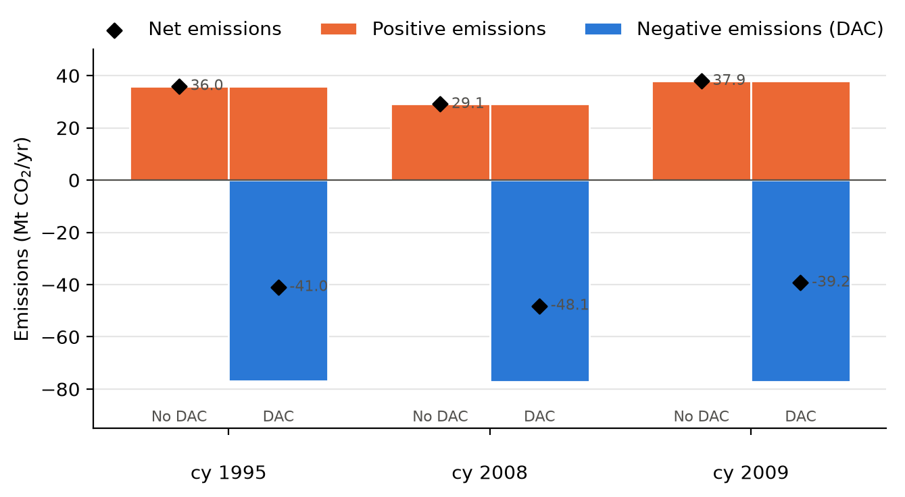
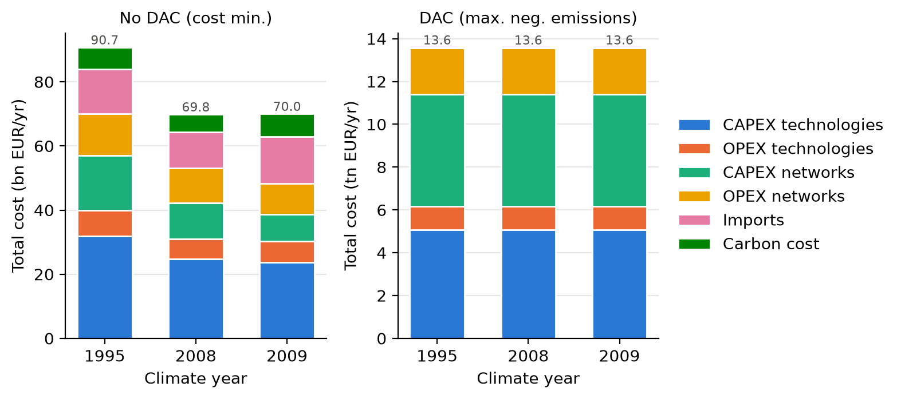
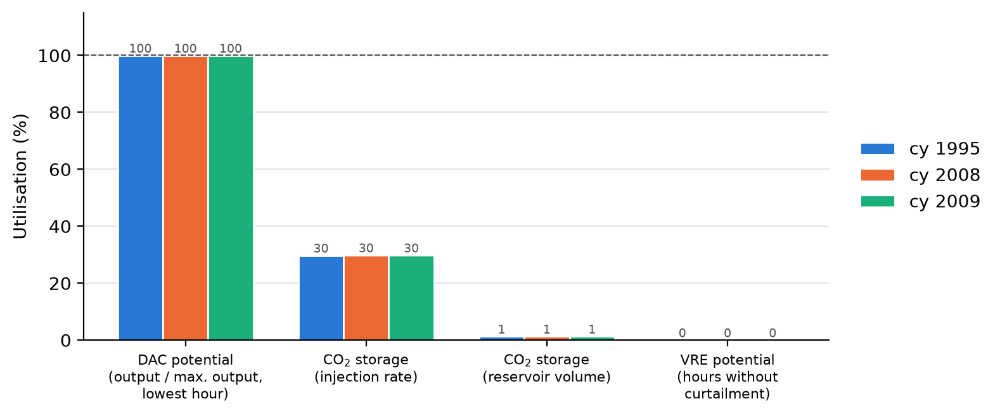
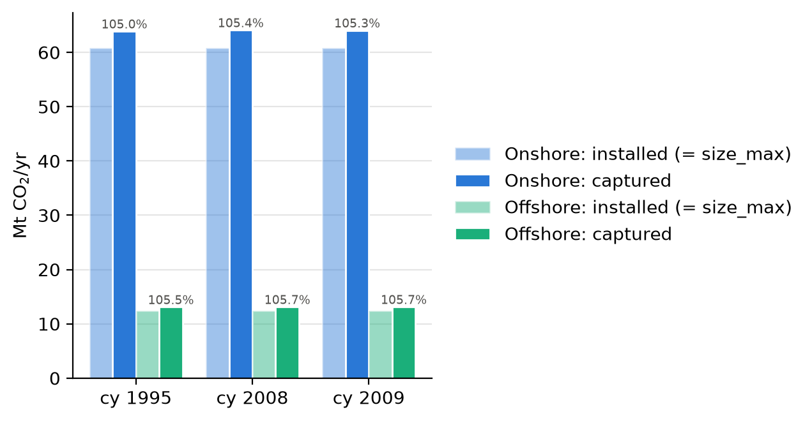
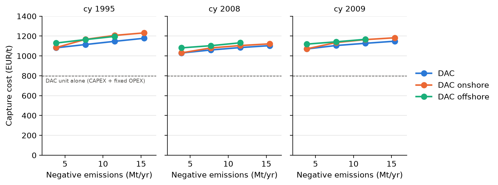
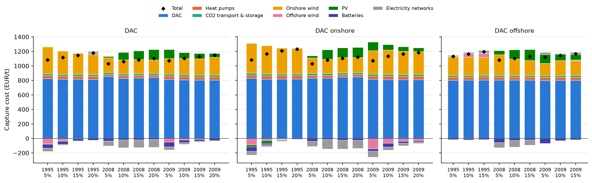
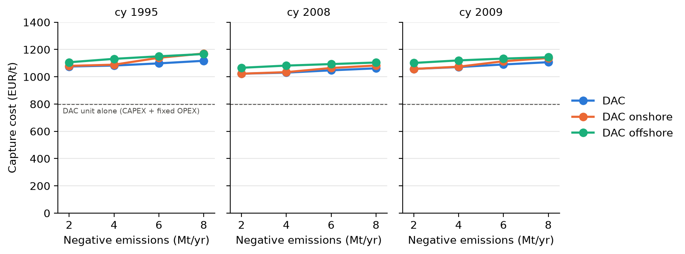
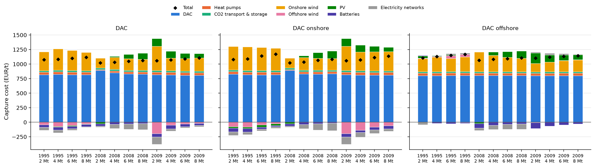

# Quick analysis: 2040 results (No DAC baseline vs. DAC max negative emissions)

*Generated by Claude, 2026-11-12, updated 2026-11-13. Data: `DAC-Offshore-MaianJan/results/2040_1`, now
complete: baseline, max, relative-target (5–20 %) and absolute-target (2–8 Mt) runs for cy 1995, 2008 and
2009, all with h5 files (75 runs). Sections 1–4 (max and baseline runs) are unchanged from the first
version.*

> **Status of the code issues (2026-11-13).** All runs in this folder were made **before** these fixes,
> so they still have the problems listed in sections 6.5 and 7:
>
> | Issue | Fixed in code | Affects these results |
> |---|---|---|
> | `neg_target_Mt*10^6` (XOR) | Yes (`08c493ea`) | No, the Mt runs reach exactly 2/4/6/8 Mt |
> | `TEST = True` | Yes (`TEST=False`) | No |
> | Baseline has no storage/flow penalty | Yes (`c347ae62`, `_optimize_cost_penalized`) | Yes, see 6.5 A |
> | Flow penalty is always 0 (`w <= f_ij, w <= f_ji` with minimisation) | Yes (`c347ae62`, penalty on total arc flow) | Yes, see 6.5 A–B |
> | Offshore wind includes the substation twice | Yes (`09c9ac69`) | Yes, see section 7 |
>
> Note that the fixed flow penalty (1 EUR per MWh or t on **all** arc flows) is much larger than before:
> roughly 0.8 bn EUR/yr in a full-year run (scaled from a 2-hour test). It isn't in `total_npv`, but it
> acts like a small transmission fee. If it's only meant to stop circulation, 0.01–0.1 is probably enough.

## 1. What is in the folder

Six runs, all `optimal`, gap 0, CO2 tax 189 EUR/t:

| Climate year | No DAC (cost minimisation) | DAC (max negative emissions) |
|---|---|---|
| 1995 | `No_DAC_baseline_cy1995_co2_tax189` | `DAC_max_neg_E_cy1995_co2_tax189` |
| 2008 | `No_DAC_baseline_cy2008_co2_tax189` | `DAC_max_neg_E_cy2008_co2_tax189` |
| 2009 | `No_DAC_baseline_cy2009_co2_tax189` | `DAC_max_neg_E_cy2009_co2_tax189` |

The max case maximises `var_emissions_neg` with positive emissions capped at the baseline of the same
climate year (`modelhub._optimize_emissions_neg`). Costs aren't in the objective, so the max runs build
everything up to its bounds and dump surplus electricity. That's by design. These runs set the **upper bound on
negative emissions**, and the main question here is which constraint sets that bound.

### Headline numbers

| | cy 1995 | cy 2008 | cy 2009 |
|---|---|---|---|
| Baseline positive emissions (Mt/yr) | 35.98 | 29.06 | 37.91 |
| Max: positive emissions (Mt/yr) | 35.98 | 29.06 | 37.91 |
| Max: negative emissions (Mt/yr) | **76.95** | **77.20** | **77.15** |
| Max: net emissions (Mt/yr) | -40.97 | -48.14 | -39.24 |
| of which onshore DAC / offshore DAC (Mt/yr) | 63.9 / 13.1 | 64.1 / 13.1 | 64.0 / 13.1 |
| No DAC total cost (bn EUR/yr) | 90.7 | 69.8 | 70.0 |
| Max total cost (tn EUR/yr) | 13.59 | 13.59 | 13.59 |

## 2. Emissions

*Figure 1: Positive and negative emissions; diamonds are net emissions.*

- **Positive emissions** in the max case equal the baseline to within 1.4 kt (0.004 %). The cap
  `emissions_pos <= baseline` is binding, as intended.
- **Negative emissions** are almost the same in every climate year (76.95–77.20 Mt, a 0.3 % spread), even
  though renewable output and baseline emissions differ a lot between climate years. That already suggests
  the bound doesn't come from the weather-dependent part of the system (Section 4).
- **Net emissions** are -39 to -48 Mt/yr. They vary almost entirely because the baseline positive
  emissions vary (2008 has the lowest baseline, so the most negative net emissions).
- The CO2 balance closes: DAC output = CO2 injected into permanent storage in every run.

## 3. Costs

*Figure 2: Cost breakdown. Note the different units: bn EUR (left) and tn EUR (right).*

- **No DAC:** 70–91 bn EUR/yr. cy 1995 is ~30 % more expensive than 2008 and 2009, which are almost
  equal. The difference comes from more technology and network CAPEX, and some offshore wind
  (NO_A, NO_B) being built in 1995.
- **Max case:** ~13.6 tn EUR/yr in every climate year (expected, since costs aren't weighted). Technology
  and network CAPEX are identical to the euro across climate years, so all new capacity is at its upper
  bound. The specific capture cost (~175,000 EUR/t) is therefore meaningless for these runs.

## 4. What sets the upper bound?

There are four candidates: **DAC potential, CO2 storage, VRE potential, and CO2 transport**. A
constraint can only set the bound if it is binding, i.e. used at 100 %.

*Figure 3: How much of each candidate constraint the max runs use (100 % = binding).*

| Candidate | Indicator | Use | Binding? |
|---|---|---|---|
| **DAC potential** | Hourly DAC output / `max_out`, lowest hour over all units | 99.9 % | **Yes** |
| CO2 storage, injection rate | Injected CO2 / Σ `injection_rate_max` × 8760 h | ~30 % | No |
| CO2 storage, reservoir volume | Stored at year end / Σ `size_max` | ~1.3 % | No |
| VRE potential | Share of hours with no curtailment | 0 % (≥ 5.2 GW curtailed in *every* hour) | No |
| CO2 transport | See below | – | No |

**Answer: the upper bound is set by the DAC potential, i.e. by DAC `size_max`.** All 16 onshore DAC units
sit at `size_max = 3.8 Mt/yr` and all 31 offshore units at `size_max = 0.4 Mt/yr` (73.2 Mt/yr nameplate). In
every hour, every unit produces exactly its `max_out` (= size × weather-dependent productivity).

*Figure 4: Installed DAC capacity (all at `size_max`) vs. CO2 captured.*

Why the other three can't be the limit:

- **VRE:** electricity is curtailed in all 8,760 hours (at least 5.2 / 7.8 / 6.8 GW in cy 1995 / 2008 /
  2009). Electricity is never scarce, so more VRE potential wouldn't increase removals. Heat isn't a
  limit either, because the heat pumps are also at their (very large) size bounds while DAC runs at
  `max_out`.
- **CO2 storage:** no storage node reaches its injection rate (highest node: NL_D at ~50 %, the rest
  lower), and reservoir volume is barely touched in a one-year run.
- **CO2 transport:** every pipeline arc is built at its size bound (500,000 t/h), compared with ~8,800 t/h
  of total DAC output. Some arcs hit 100 % flow in some hours, but only because the solution circulates
  CO2 (dumping, which is fine). Since every DAC unit already produces its maximum in every hour, transport
  can't be what limits the bound.

What this means: the ~77 Mt/yr "maximum" is essentially Σ DAC `size_max` × ~105 % productivity. The
emission targets of the `cost_at_emission_reduction` runs (x % of this maximum) scale directly with the
DAC `size_max` assumption. The next limit, if DAC `size_max` were raised, would probably be CO2
injection at the storage sites. On aggregate there's room for ~3.3×, but individual sites (NL_D) would
hit their limit sooner, depending on transport.

## 5. Relative emission targets (5–20 % of max): capture costs

### 5.1 What is available

All relative-target runs now have a summary and an h5 file (33 runs): DAC and onshore-only 5–20 %,
offshore-only 5–15 % in every climate year. Offshore-only can't reach 20 % (15.4 Mt), because all
offshore DAC at `size_max` captures only ~13 Mt (31 × 0.4 Mt × 1.05).

All runs are `optimal`. Each target applies to the max of the *combined* DAC case of that climate year,
so the three configurations remove the same amount of CO2 and can be compared directly. The capture cost
is `(total_npv − total_npv of No DAC) / emissions_neg`, as in `postprocessing.py`. In every target run,
positive emissions, carbon cost and import costs equal the baseline. The `emissions_pos <= baseline` cap
binds, so all DAC energy comes from additional renewables and storage, not gas.

### 5.2 Average and marginal capture cost

| cy | Config | 5 % (3.9 Mt) | 10 % (7.7 Mt) | 15 % (11.6 Mt) | 20 % (15.4 Mt) | Marginal per step |
|---|---|---|---|---|---|---|
| 1995 | DAC | 1,082 | 1,115 | 1,147 | 1,178 | 1,147 → 1,212 → 1,269 |
| 1995 | onshore only | 1,084 | 1,166 | 1,207 | 1,232 | 1,249 → 1,287 → 1,307 |
| 1995 | offshore only | 1,130 | 1,164 | 1,196 | – | 1,199 → 1,261 |
| 2008 | DAC | 1,030 | 1,060 | 1,084 | 1,103 | 1,090 → 1,132 → 1,161 |
| 2008 | onshore only | 1,031 | 1,080 | 1,104 | 1,121 | 1,130 → 1,152 → 1,173 |
| 2008 | offshore only | 1,081 | 1,103 | 1,132 | – | 1,125 → 1,190 |
| 2009 | DAC | 1,070 | 1,105 | 1,127 | 1,148 | 1,139 → 1,172 → 1,211 |
| 2009 | onshore only | 1,071 | 1,135 | 1,164 | 1,183 | 1,198 → 1,223 → 1,238 |
| 2009 | offshore only | 1,119 | 1,142 | 1,167 | – | 1,165 → 1,218 |

*EUR/t CO2, relative to No DAC of the same climate year. The values that were already in the first
version are unchanged; new are cy 2008 15–20 % and 1995 onshore-only 20 %.*

*Figure 5: Average capture cost vs. removed CO2. Dashed: DAC unit alone (annualised CAPEX + fixed OPEX
at 105 % productivity, from the input data).*

### 5.3 Where the cost comes from (h5 data)

*Figure 6: Additional annualised cost per tonne vs. No DAC, by technology. Diamonds are the total from
the summary. Power plants and hydro (< 5 EUR/t) are only in the total.*

The technology costs from the h5 files match `cost_capex_tecs` and `cost_opex_tecs` exactly. Network
costs match after dividing by 2, because every arc is stored in both directions.

| Component | EUR/t | What drives it |
|---|---|---|
| DAC unit | 800–853 | Mostly run as **baseload** (captured/size = 0.99–1.05). Highest when NO1 onshore dominates (lower productivity) and in cy 2008, where DAC runs more flexibly (6.5 D) |
| Heat pumps | 31–47 | Air-source heat pumps at COP ≈ 1.45 (1.2–1.5 in the hours they run) supply 2.1–4.4 MWh_th/t; the rest of the heat comes from ohmic heating in the DAC unit |
| CO2 transport & storage | 23–27 | Storage 23 EUR/t (variable OPEX); pipelines only 1–4 EUR/t, as DAC sits at or next to storage nodes |
| Electricity supply (wind, PV, batteries, networks) | ~120–340 net | DAC uses ~4–5.5 MWh_el/t in total (process, ohmic heating and heat pumps) |

**Correction to the first version:** the h5 variable `heat_input` of the DAC is only the heat bought from
the heat carrier. `DAC_Adsorption_*.json` has `ohmic_heating = 1`, so the unit can also heat directly with
electricity (`eta_elth = 0.97`), and that electricity is part of `electricity_input`. The DAC heat demand is
therefore **4.8–5.1 MWh_th/t** (not 3.6–4.4), and the process electricity is only **0.70–0.76 MWh_el/t**
(not 0.7–2.0). Ohmic heating uses 0.4–1.1 MWh_el/t in 1995, 0.9–1.2 in 2009 and 1.2–3.0 in 2008.

**Where DAC is built:** the combined case first fills NO1 onshore (up to `size_max` = 3.8 Mt). Above
that it adds offshore DAC at NO, UK and DK nodes rather than other onshore nodes. Other onshore nodes
(DK1, UK1, UK3) only appear at 20 %. Onshore-only goes NO1 → UK3 → DK1/UK1 → BE/DE/NL.

### 5.4 Are the values sensible?

**Internally consistent, yes.** I found no sign of a modelling error in the capture costs:

- **Cost rises with the target, and marginal > average.**
- **Combined DAC is never more expensive than onshore-only or offshore-only** (all comparable pairs).
- **The offshore option becomes more valuable with the target.** Combined vs. onshore-only saves
  ~1–2 EUR/t at 5 % but 20–60 EUR/t at 10–20 %. In 1995 offshore-only is even cheaper than onshore-only at
  15 % (1,196 vs. 1,207 EUR/t).
- **Balances close.** The heat balance closes (DAC heat comes from heat pumps and ohmic heating, with no
  imports or generic production). The CO2 balance closes. Positive emissions stay at the baseline.
- **Climate years rank consistently** (2008 cheapest, 1995 most expensive).

**The absolute level (~1,030–1,310 EUR/t) is set by the inputs.** About 75 % is the DAC unit (5,673
EUR/(t/yr), 10 % discount rate). That's high compared with typical 2040–2050 projections of a few hundred
EUR/t. The energy share is moderate even though DAC energy use is high (see 5.5, point 3).

### 5.5 Observations worth checking

1. **Offshore DAC is not powered by offshore wind.** Even in the offshore-only runs, new offshore wind
   adds only −1 to 54 EUR/t, while onshore wind adds 170–255 EUR/t and PV up to 120 EUR/t. That electricity
   reaches the offshore DAC through the grid (electricity networks +7 to +36 EUR/t in the offshore-only
   runs). The model chooses offshore sites for **DAC performance**, not for energy. Offshore DAC has a
   slightly higher productivity (1.05 vs. 1.01–1.04) and needs 3–6 % less energy (0.70 MWh_el + 4.78
   MWh_th per t, vs. 0.71–0.76 + 4.9–5.1 onshore). That comes from the milder offshore climate in the
   inputs (mean 8 °C, no frost, vs. −0.2 °C at NO1). *(The first version compared DAC electricity use of
   0.7–1.4 vs. 1.8 MWh_el/t. That difference came mostly from ohmic heating, not from the DAC process.)*
   If the paper argues for co-location with offshore wind, these results don't show it. Note that
   offshore wind is still too expensive in these runs (section 7).
2. **The network cost reduction is a substitution, not an error.** The DAC runs build onshore wind at
   NO1, NL3 and DK1 (+1.4 to +4.5 GW) and PV in DE1, UK1 and BE (+1–4 GW). In exchange they build less
   offshore wind (NO_A −0.9 GW in 1995, UK_K −1.3 GW in 2009) and fewer DC links that came with it
   (DK1–DK_A–NO_A, UK3–UK_K). The extra local onshore generation also serves demand, so the baseline's
   offshore wind and transmission are partly no longer needed. In the onshore-only runs this shows up as
   −140 EUR/t offshore wind and −80 EUR/t networks at 5 %.
3. **DAC energy use is high.** It's 4.8–5.1 MWh_th/t of heat plus 0.70–0.76 MWh_el/t of process
   electricity. That comes from the Rezo "max productivity" performance data and is well above the
   ~1.5–2.5 MWh_th/t often quoted for solid-sorbent DAC. The cost effect is limited (~100 EUR/t if heat
   demand halved), because the DAC CAPEX dominates.
4. **Baseline and target runs use different objectives.** See 6.5 A: the target runs pay a storage
   penalty of 29–33 M EUR that the baseline doesn't, and the flow penalty is 0 everywhere.
5. **Onshore and offshore DAC have identical cost data.** If offshore DAC should carry platform or
   installation costs, the offshore results are optimistic.
6. **Small barrier residuals.** With `Crossover 0`, 236 of the 242 CO2 pipeline arcs have capex > 0 even
   though their size is ~0. It's a few M EUR in total, so it doesn't matter for costs. Use a threshold when
   plotting networks.
7. **Removals earn no CO2 price.** With a 189 EUR/t credit, net costs would be ~190 EUR/t lower.

## 6. Absolute emission targets (2–8 Mt)

### 6.1 What is available

36 runs: DAC, onshore-only and offshore-only × 2, 4, 6 and 8 Mt × cy 1995, 2008 and 2009, all `optimal`
with h5 files. The targets are met exactly (`emissions_neg` = 2.000/4.000/6.000/8.000 Mt), so the
`10^6` bug is not in these runs. Positive emissions equal the baseline. The solver logs only show the
usual Gurobi warnings (large bounds, RHS and coefficient range), as in the other runs.

These runs were made **before** the fixes to the baseline penalty, the flow penalty and the offshore
wind cost (see the status box at the top and 6.5).

### 6.2 Average and marginal capture cost

| cy | Config | 2 Mt | 4 Mt | 6 Mt | 8 Mt | Marginal per step |
|---|---|---|---|---|---|---|
| 1995 | DAC | 1,075 | 1,082 | 1,098 | 1,117 | 1,089 → 1,130 → 1,174 |
| 1995 | onshore only | 1,080 | 1,089 | 1,139 | 1,171 | 1,097 → 1,241 → 1,264 |
| 1995 | offshore only | 1,106 | 1,131 | 1,150 | 1,167 | 1,157 → 1,187 → 1,217 |
| 2008 | DAC | 1,023 | 1,030 | 1,047 | 1,062 | 1,038 → 1,081 → 1,105 |
| 2008 | onshore only | 1,023 | 1,034 | 1,064 | 1,082 | 1,045 → 1,125 → 1,137 |
| 2008 | offshore only | 1,066 | 1,082 | 1,093 | 1,104 | 1,098 → 1,115 → 1,139 |
| 2009 | DAC | 1,058 | 1,071 | 1,090 | 1,107 | 1,085 → 1,128 → 1,156 |
| 2009 | onshore only | 1,058 | 1,074 | 1,114 | 1,138 | 1,090 → 1,194 → 1,209 |
| 2009 | offshore only | 1,101 | 1,120 | 1,133 | 1,143 | 1,139 → 1,160 → 1,173 |

*EUR/t CO2, relative to the (unpenalised) No DAC run of the same climate year.*

*Figure 7: Average capture cost vs. removed CO2 for the absolute targets.*

**Main results:**
- **Combined ≤ onshore-only ≤ offshore-only up to 6 Mt.** At 8 Mt offshore-only catches up with
  onshore-only (1995: 1,167 vs. 1,171 EUR/t; 2009: 1,143 vs. 1,138).
- **At 2 Mt the combined case is the onshore case.** In 2008 and 2009 combined and onshore-only have the
  same cost and the same design (NO1 only). In 1995 the combined case already adds 0.8 Mt of offshore DAC
  at NO_A/NO_B, saving 5 EUR/t.
- **Onshore gets expensive above ~4 Mt.** NO1 is full at `size_max` = 3.8 Mt (~3.95 Mt captured). The
  marginal cost of onshore-only then jumps by 80–145 EUR/t (1995: 1,097 → 1,241; 2009: 1,090 → 1,194),
  because the next onshore sites (UK3, UK1, DK1) are worse. The combined case avoids most of this jump by
  adding offshore DAC. So the value of offshore DAC is in the **4–8 Mt range**: 17–54 EUR/t cheaper than
  onshore-only at 6–8 Mt.

### 6.3 Consistent with the relative-target runs

Sorting the relative and absolute runs together by removed CO2 gives one smooth, convex cost curve per
configuration and climate year. For example, cy 1995 DAC: 2 Mt → 5 % (3.85 Mt) → 4 Mt → 6 Mt → 10 %
(7.69 Mt) → 8 Mt → 15 % → 20 % has slopes of 1,089, 1,093, 1,130, 1,172, 1,181, 1,214 and 1,269 EUR/t.
So the two sets of runs agree, and the absolute runs fill in the low end of the curve.

### 6.4 Where the cost comes from and where DAC is built

*Figure 8: Additional annualised cost per tonne vs. No DAC, by technology, absolute targets.*

| Component | EUR/t | Comment |
|---|---|---|
| DAC unit | 799–892 | 892 in cy 2008 at 2 Mt (combined = onshore-only), see 6.5 D |
| Heat pumps | 14–47 | 14 in cy 2008 at 2 Mt, where ohmic heating supplies most of the heat |
| CO2 transport & storage | 23–27 | |
| Electricity supply, net | 87–299 | Large shifts between technologies: e.g. cy 2009 at 2 Mt: onshore wind +418, PV +131, offshore wind −196, networks −127 EUR/t (the substitution of 5.5, point 2) |

DAC sites:
- **Combined:** NO1 first (1.1–2.1 Mt size at 2 Mt, 3.8 Mt from 6 Mt on), then offshore at NO_A/NO_B,
  UK_D–UK_L, DK_A/DK_C and NL_A/NL_B. No other onshore node is used up to 8 Mt.
- **Onshore-only:** 1995 and 2009: NO1 → UK3 → UK1/DK1. In 2008 the sites are much more spread
  out: at 4 Mt eight nodes (DE2, DE3, DK1, NO1, UK1–UK4), at 8 Mt 16 nodes in BE, DE, DK, NL, NO and UK.
- **Offshore-only:** 7 nodes at 2 Mt to 21–26 nodes at 8 Mt, each at ≤ 0.4 Mt.

**Offshore wind is almost never part of the DAC response.** New offshore wind is ~23 GW in every cy 1995
run (also without DAC), 0 GW in every cy 2008 run and 0.3–1.6 GW in cy 2009. DAC changes it by at most
±1.3 GW. This is with the too-expensive offshore wind (section 7).

### 6.5 Problems in these runs

**A. Penalties: baseline and target runs still have different objectives, and the flow penalty is 0.**
For every target run, `ub − total_npv` (the solver objective minus the NPV) equals the storage penalty
(0.1 EUR/MWh × electricity storage charge + discharge) to within 0.1 EUR. So the bidirectional flow
penalty contributed **exactly nothing** (as expected from the bug: `w <= f_ij`, `w <= f_ji` with
minimisation always gives `w = 0`).

| | cy 1995 | cy 2008 | cy 2009 |
|---|---|---|---|
| Storage penalty in target runs (M EUR) | 33.0–33.3 | 29.6–30.2 | 29.0–29.2 |
| Same penalty evaluated on the baseline (M EUR, not in its objective) | 34.8 | 36.4 | 34.0 |
| Penalty per tonne at 2 Mt / 8 Mt (EUR/t, in objective only) | 16.6 / 4.1 | 14.8 / 3.7 | 14.5 / 3.6 |

The penalty is not in `total_npv`, so it doesn't enter the capture cost directly. But it changes the
solution: the target runs cycle 5–20 % less storage than the baseline. The NPV increase this causes is at
most the penalty saved, i.e. roughly **2–7 M EUR, or ≤ 1–3.5 EUR/t at 2 Mt and ≤ 1 EUR/t at 8 Mt**. That's
small, but differences between configurations of a few EUR/t at 2 Mt are not robust (e.g. combined vs.
onshore-only in 1995: 5 EUR/t). The penalties themselves are artificial, so the cleanest comparison is
baseline and target runs with the same (fixed) penalties, as now implemented.

**B. Circulating electricity flows.** In every run, also in the baseline, 0.8–3.7 % of all electricity arc
flow goes in both directions of a connection in the same hour (12–47 TWh/yr in the target runs, 23–51
TWh/yr in the baselines). It costs nothing (no variable network OPEX, negligible losses, electricity is
curtailed anyway), so it doesn't change costs. But hourly network flows and "transmitted energy" from
these runs are inflated; net the two directions before plotting. CO2 circulation is negligible
(< 1,100 t/yr). With the fixed flow penalty both should disappear. (`data/penalty_check.csv`)

**C. Offshore wind is too expensive** (section 7). This disadvantages every option that relies on
offshore wind, so the offshore wind build-out and possibly the offshore DAC results will change after the
fix (`09c9ac69`). From the current runs, offshore DAC doesn't rely on offshore wind (6.4), so I'd expect
the effect on the capture cost to be moderate, but the runs need to be repeated to know.

**D. cy 2008: DAC runs flexibly and heats mostly with ohmic heating.** At 2 Mt (combined = onshore-only,
all at NO1), 4.2 of the 5.0 MWh_el/t DAC electricity is ohmic heating; heat pumps supply only 0.9
MWh_th/t. DAC runs below half load in 13 % of the hours (utilisation 0.94 instead of ~1.03), so 2.12 Mt
of capacity is built for 2.0 Mt. That raises the DAC unit cost to 892 EUR/t, but 2008 is still the
cheapest climate year. In 1995 and 2009 the NO1 heat pumps run in 82–86 % of the hours, in 2008 only in
57 %. This looks like a consistent model choice, not a bug: ohmic heating (efficiency 0.97) has **no
CAPEX of its own**, so where electricity is cheap or curtailed (NO1 in 2008), the model saves heat-pump
capacity (COP only ≈ 1.45) and runs DAC with the cheap electricity. Whether that's realistic depends on
whether the DAC CAPEX includes an ohmic heater sized for the full heat demand (question 10).

**E. Small residual DAC sizes.** As in the relative runs, some nodes get tiny DAC sizes (e.g. UK_K in
cy 2009 combined at 2 Mt: 73 t; the other offshore nodes < 1 t). Use a threshold when listing DAC sites.

## 7. Offshore wind cost assumption

**Short answer: yes, offshore wind is too expensive in the model, by roughly 20–40 %, mainly because the
offshore HVDC converter is counted twice.** This likely explains why offshore wind is almost never built
(also not for offshore DAC, 5.5 point 1 and 6.4). *Since fixed in `09c9ac69` (substation removed); all runs in the results folder still use the old cost.*

**Where the number comes from.** `Offshore_Wind` uses 3.14 M EUR2025/MW (`TechnologyCost.xlsx`, sheet
`ToModel_2025`, year 2040). That is DEA *Far shore wind, DC connected, fixed bottom* (2040): total 2.90
M EUR2020/MW minus export cables (0.53), so 2.37, × 1.325 (euro-area PPI 2020→2025). It still includes
the **offshore substation (0.97 M EUR2020/MW = 1.29 M EUR2025/MW)**, which for a DC-connected farm is the
HVDC converter platform.

**The DC links charge for the converter again.** A new `electricityDC_offshore` arc costs 0.77 M EUR/MW
(converter pair, `gamma2`) plus 3,910 EUR/MW/km (`NetworkCost.xlsx`). Offshore wind does use such links.
In the 1995 baseline, the 22.9 GW at NO_A are exported through ~21 GW of new DC links (NO_A–DE_B 10 GW,
NO_A–NO1 4.7 GW, NO_A–DE_I 3.4 GW, …), each paying its own converter pair.

| MEUR2025/MW (2040) | Value |
|---|---|
| DEA total (turbine, foundation, array, substation, export cable) | 3.84 |
| DEA without substation and export cable | 1.86 |
| **Model `Offshore_Wind`** | **3.14** |
| Model DC link, 175 km (DEA reference distance) | 1.45 |
| **Model wind + DC link** | **4.59** (+20 % vs. DEA total) |
| Consistent alternative: DEA without substation/export cable + DC link | 3.31 |

For reference, IRENA reports a global average installed cost of ~2,800 USD/kW (≈ 2.6 M EUR/MW, incl.
grid connection) for offshore wind commissioned in 2023 [1]. The model's 3.14 M EUR/MW for the wind farm
alone, or 4.6 incl. the link, for 2040 is clearly at the high end.

**Effect on LCOE** (model inputs, 10 % discount rate, CF 56.5 % offshore / 34 % onshore / 9.5 % PV, from
the model's capacity factors):

| | EUR/MWh |
|---|---|
| Onshore wind | 62 |
| PV | 73 |
| Offshore wind (model) | 78 |
| Offshore wind (model) + DC link to shore | 120 |
| Offshore wind without substation | 48 |
| Offshore wind without substation + DC link | 89 |

With the double counting removed, offshore wind at the farm (48 EUR/MWh) is cheaper than onshore wind
(62). Including the link it's still more expensive (89), but the gap shrinks a lot. Wherever an offshore
DAC or demand sits next to the wind farm, no long link is needed at all.

Two smaller points:
- **PPI inflation:** all costs are inflated with the euro-area producer price index (×1.325 for
  2020→2025), which includes the 2022 energy price spike. A consumer-price index would give roughly ×1.2,
  i.e. ~10 % lower costs. This applies to all technologies, so it shifts levels, not the merit order.
- **Onshore wind and PV look consistent with DEA.** Onshore is 1.47 M EUR2025/MW = DEA 2040 1.11 × 1.325;
  PV is 0.5 M EUR/MW.

**Suggestion:** use DEA without substation and export cable (1.86 M EUR2025/MW) for `Offshore_Wind`, and
let the DC network carry the converter and cable costs. Or keep the substation in the wind cost and drop
the converter share (`gamma2`) for links that start at offshore wind nodes. Either way, offshore wind
results (and the offshore DAC energy supply) would likely change. Re-run at least one target case to check.

[1] [IRENA, Renewable Power Generation Costs in 2023](https://www.irena.org/Publications/2024/Sep/Renewable-Power-Generation-Costs-in-2023)

## 8. Flags from the max runs

**Flag 1 – DAC captures ~105 % of its nameplate size.** Captured / installed = 105.0–105.7 % for onshore
and offshore in every climate year. `max_out` reaches 466.26 t/h for a 3.8 Mt/yr unit, while
3.8 Mt / 8760 h = 433.8 t/h. So either `size` is a reference capacity that the `rezo` performance model may
exceed, or there is a normalisation issue. On top of that, the `Units` block of `DAC_Adsorption_*.json` says
`"size": "MW"`, while CAPEX is per tCO2/yr and the results behave like t/yr. Because DAC sets the upper bound,
this 5 % feeds straight into the max and into all % targets.

**Flag 2 – Summary reports `objective = costs` for the max runs.** The solver log shows `(Max)` with an
objective of 7.69e7 (= `emissions_neg`), so the label in `Summary.xlsx` is wrong. That's cosmetic, but it's
risky when filtering summaries later.

**Flag 3 – Numerics (minor).** Gurobi warns about large bounds (up to 1e13) and RHS (2e9), and the matrix
range is 3e-6…9e5. The solutions are reported optimal, and the emission numbers are consistent (CO2 balance
closes, positive cap holds), so I don't see an actual problem.

**Checked and fine:** huge max-case costs and dumping (by design); positive emissions = baseline; CO2
balance; offshore wind sizes. All offshore wind sizes equal `RemainingPotential_Wind_off` in
`max_re_nodes.csv` (or the 125 GW cap), so the earlier ×1000 potential error
(`validate_vre_potential/notes.md`) does not show up here.

## 9. Open questions

1. Is DAC `size_max` (3.8 Mt/yr onshore, 0.4 Mt/yr offshore per node) meant to define the upper bound? If
   the bound should reflect storage, VRE or transport instead, DAC `size_max` has to be loosened.
2. Is DAC `size` in t/yr, and is output > nameplate (Flag 1) intended?
3. Should negative emissions earn carbon revenue? Right now only positive emissions are charged
   (`carbon_revenue = 0`).
4. Is the DAC CAPEX of 5,673 EUR/(t/yr) with a 10 % discount rate the intended 2040 assumption? It drives
   ~75 % of the ~1,100 EUR/t capture cost.
5. Should offshore DAC carry extra costs (platform, installation) compared with onshore DAC?
6. Is offshore DAC meant to be co-located with offshore wind? In the results it is powered by onshore
   wind and PV through the grid, and chosen for its better DAC performance in the offshore climate (5.5,
   point 1).
7. Is the DAC energy use from the Rezo "max productivity" data (~5 MWh_th/t heat) intended (5.5, point 3)?
8. ~~Can you add the cy 2008 h5 files and the 1995 onshore-only runs?~~ Done, all runs are now in the folder.
9. ~~Is the offshore substation meant to be in `Offshore_Wind` *and* the converter in the DC links?~~ Fixed in `09c9ac69` (section 7).
10. Does the DAC CAPEX include an ohmic heater sized for the full heat demand? Ohmic heating has no CAPEX
    of its own in the model, and in cy 2008 it supplies most of the DAC heat (6.5 D). If it should cost
    extra, add it or set `ohmic_heating = 0`.
11. Is a flow penalty of 1 EUR per MWh or t on all arc flows intended (status box at the top)? A value of
    0.01–0.1 would probably be enough to remove circulation (6.5 B).

## 10. Code

Run from the repository root, in this order:

| Script | What it does |
|---|---|
| `concat_summaries.py` | Reads every `<cy>/<case>/Summary.xlsx` under `ROOT_PATH`, appends them into one table, adds `dac_configuration`, `emission_target`, `climate_year`, `result_path` and `specific_capture_cost` → `data/Summary_2040_processed.csv` |
| `extract_run_metrics.py` | Reads design and selected operation data from each h5 file (DAC output and energy use, CO2 stored, RE generation and curtailment, network design, and how much of each candidate upper-bound constraint is used) → `data/technology_design.csv`, `data/network_design.csv`, `data/run_metrics.csv`. Run as `python -m dac_offshore.claude_quick_analysis.extract_run_metrics` (it imports `validate_vre_potential.read_data`) |
| `plot_results.py` | Makes figures 1–4 (max and baseline runs) in `figures/` |
| `check_offshore_wind_cost.py` | Compares the offshore wind CAPEX with the DEA source data and computes LCOEs with the model inputs → `data/offshore_wind_cost_check.csv` |
| `plot_capture_costs.py` | Average and marginal capture cost from the summary (→ `data/capture_costs.csv`, figures 5 and 7); capture cost by technology and DAC operation incl. ohmic heating from the h5 data (→ `data/capture_cost_by_technology.csv`, `data/dac_operation.csv`, figures 6 and 8). Relative and absolute targets are handled separately (`target_type`) |
| `check_penalties.py` | Compares `ub − total_npv` with the storage penalty and computes the circulating flows per run → `data/penalty_check.csv` (section 6.5 A–B) |

`ROOT_PATH` in `concat_summaries.py` points to `results/2040_1`, which now contains all runs, so the
first-download summary (`data/Summary_2040_processed_first_glance.csv`) is no longer used.
`extract_run_metrics.py` skips runs without an h5 file; it now also extracts the storage throughput, total
and circulating network flows, and the DAC ohmic heating. Reading all 75 h5 files takes ~3 minutes.
Figures 1–4 were regenerated and now include cy 2008.

*The scripts were missing from this branch and were restored from `first_glance_results`.*
