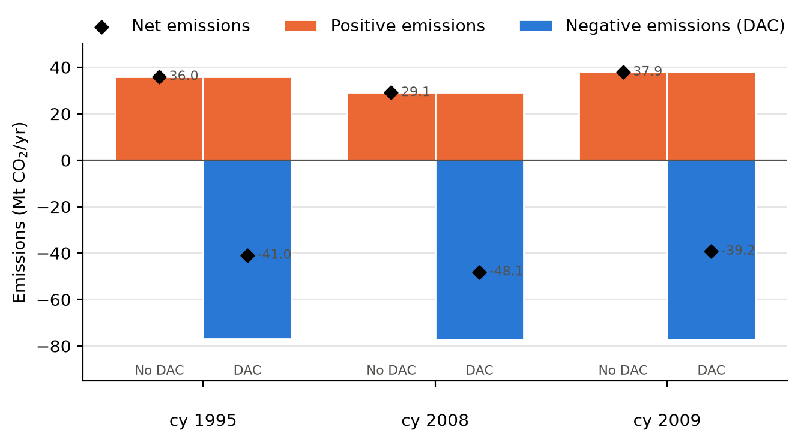
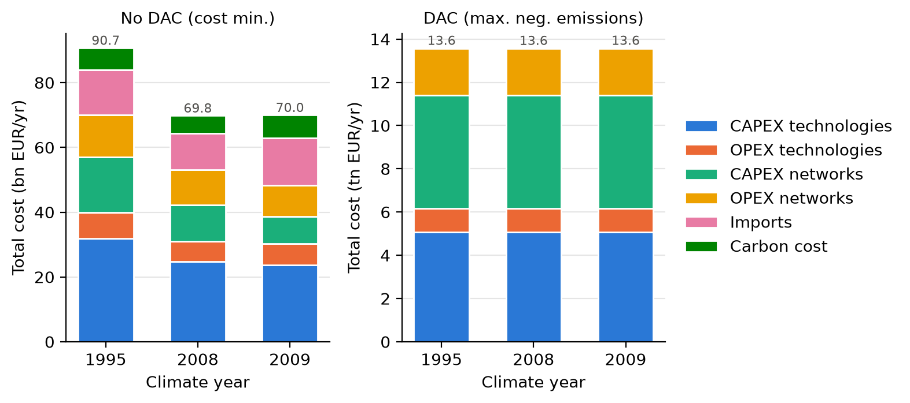
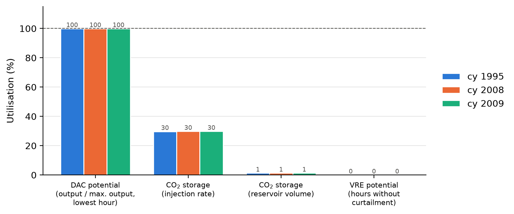
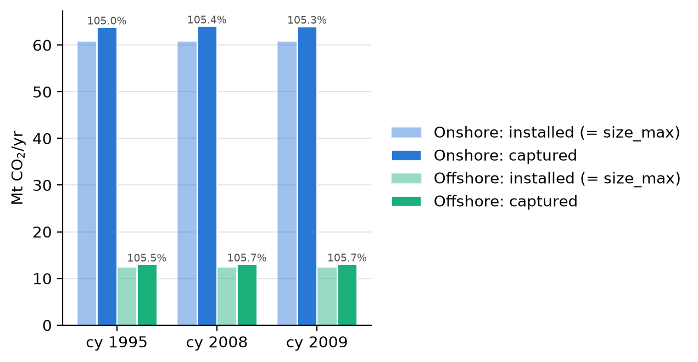

# Quick analysis: 2040 results (No DAC baseline vs. DAC max negative emissions)

*Generated by Claude, 2026-11-12. Data: `DAC-Offshore-MaianJan/2040` (sections 1–4, max and baseline
runs, from the h5 files) and `DAC-Offshore-MaianJan/2040_1` (section 5, emission-target runs, from
`Summary.xlsx` and solver logs only).*

> **Bug to fix before the new absolute-target runs:** `dac_offshore/model_api.py:135` has
> `neg_target_t = neg_target_Mt*10^6`. In Python `^` is XOR, so this is `(neg_target_Mt*10) ^ 6`. For
> `NEGATIVE_EMMISSIONS_MT = [2, 4, 6, 8]` the targets become **18, 46, 58 and 86 t** instead of 2–8 Mt
> (and a float input would crash). It should be `neg_target_Mt * 1e6`. Also, `TEST = True` is set in
> `global_vars.py`; check that this is intended for the Euler runs.

## 1. What is in the folder

Six runs, all `optimal`, gap 0, CO2 tax 189 EUR/t:

| Climate year | No DAC (cost minimisation) | DAC (max negative emissions) |
|---|---|---|
| 1995 | `No_DAC_baseline_cy1995_co2_tax189` | `DAC_max_neg_E_cy1995_co2_tax189` |
| 2008 | `No_DAC_baseline_cy2008_co2_tax189` | `DAC_max_neg_E_cy2008_co2_tax189` |
| 2009 | `No_DAC_baseline_cy2009_co2_tax189` | `DAC_max_neg_E_cy2009_co2_tax189` |

The max case maximises `var_emissions_neg` with positive emissions capped at the baseline of the same
climate year (`modelhub._optimize_emissions_neg`). Costs aren't in the objective, so the max runs build
everything up to its bounds and dump surplus electricity. That's by design. These runs set the **upper bound on
negative emissions**, and the main question here is which constraint sets that bound.

### Headline numbers

| | cy 1995 | cy 2008 | cy 2009 |
|---|---|---|---|
| Baseline positive emissions (Mt/yr) | 35.98 | 29.06 | 37.91 |
| Max: positive emissions (Mt/yr) | 35.98 | 29.06 | 37.91 |
| Max: negative emissions (Mt/yr) | **76.95** | **77.20** | **77.15** |
| Max: net emissions (Mt/yr) | -40.97 | -48.14 | -39.24 |
| of which onshore DAC / offshore DAC (Mt/yr) | 63.9 / 13.1 | 64.1 / 13.1 | 64.0 / 13.1 |
| No DAC total cost (bn EUR/yr) | 90.7 | 69.8 | 70.0 |
| Max total cost (tn EUR/yr) | 13.59 | 13.59 | 13.59 |

## 2. Emissions

*Figure 1: Positive and negative emissions; diamonds are net emissions.*

- **Positive emissions** in the max case equal the baseline to within 1.4 kt (0.004 %). The cap
  `emissions_pos <= baseline` is binding, as intended.
- **Negative emissions** are almost the same in every climate year (76.95–77.20 Mt, a 0.3 % spread), even
  though renewable output and baseline emissions differ a lot between climate years. That already suggests
  the bound doesn't come from the weather-dependent part of the system (Section 4).
- **Net emissions** are -39 to -48 Mt/yr. They vary almost entirely because the baseline positive
  emissions vary (2008 has the lowest baseline, so the most negative net emissions).
- The CO2 balance closes: DAC output = CO2 injected into permanent storage in every run.

## 3. Costs

*Figure 2: Cost breakdown. Note the different units: bn EUR (left) and tn EUR (right).*

- **No DAC:** 70–91 bn EUR/yr. cy 1995 is ~30 % more expensive than 2008 and 2009, which are almost
  equal. The difference comes from more technology and network CAPEX, and some offshore wind
  (NO_A, NO_B) being built in 1995.
- **Max case:** ~13.6 tn EUR/yr in every climate year (expected, since costs aren't weighted). Technology
  and network CAPEX are identical to the euro across climate years, so all new capacity is at its upper
  bound. The specific capture cost (~175,000 EUR/t) is therefore meaningless for these runs.

## 4. What sets the upper bound?

There are four candidates: **DAC potential, CO2 storage, VRE potential, and CO2 transport**. A
constraint can only set the bound if it is binding, i.e. used at 100 %.

*Figure 3: How much of each candidate constraint the max runs use (100 % = binding).*

| Candidate | Indicator | Use | Binding? |
|---|---|---|---|
| **DAC potential** | Hourly DAC output / `max_out`, lowest hour over all units | 99.9 % | **Yes** |
| CO2 storage, injection rate | Injected CO2 / Σ `injection_rate_max` × 8760 h | ~30 % | No |
| CO2 storage, reservoir volume | Stored at year end / Σ `size_max` | ~1.3 % | No |
| VRE potential | Share of hours with no curtailment | 0 % (≥ 5.2 GW curtailed in *every* hour) | No |
| CO2 transport | See below | – | No |

**Answer: the upper bound is set by the DAC potential, i.e. by DAC `size_max`.** All 16 onshore DAC units
sit at `size_max = 3.8 Mt/yr` and all 31 offshore units at `size_max = 0.4 Mt/yr` (73.2 Mt/yr nameplate). In
every hour, every unit produces exactly its `max_out` (= size × weather-dependent productivity).

*Figure 4: Installed DAC capacity (all at `size_max`) vs. CO2 captured.*

Why the other three can't be the limit:

- **VRE:** electricity is curtailed in all 8,760 hours (at least 5.2 / 7.8 / 6.8 GW in cy 1995 / 2008 /
  2009). Electricity is never scarce, so more VRE potential wouldn't increase removals. Heat isn't a
  limit either, because the heat pumps are also at their (very large) size bounds while DAC runs at
  `max_out`.
- **CO2 storage:** no storage node reaches its injection rate (highest node: NL_D at ~50 %, the rest
  lower), and reservoir volume is barely touched in a one-year run.
- **CO2 transport:** every pipeline arc is built at its size bound (500,000 t/h), compared with ~8,800 t/h
  of total DAC output. Some arcs hit 100 % flow in some hours, but only because the solution circulates
  CO2 (dumping, which is fine). Since every DAC unit already produces its maximum in every hour, transport
  can't be what limits the bound.

What this means: the ~77 Mt/yr "maximum" is essentially Σ DAC `size_max` × ~105 % productivity. The
emission targets of the `cost_at_emission_reduction` runs (x % of this maximum) scale directly with the
DAC `size_max` assumption. The next limit, if DAC `size_max` were raised, would probably be CO2
injection at the storage sites. On aggregate there's room for ~3.3×, but individual sites (NL_D) would
hit their limit sooner, depending on transport.

## 5. Emission-target runs (2040_1): capture costs

### 5.1 What is available

24 of 36 target runs are finished: 5 %, 10 % and 15 % of the max, for DAC (combined), DAC onshore only and
DAC offshore only. Missing: all 20 % runs, 15 % for onshore-only (2008, 2009) and offshore-only (all
years), and DAC 10 % cy 2009 (still in barrier). All finished runs are `optimal`. Each target applies to
the max of the *combined* DAC case of that climate year, so all three configurations remove the same
amount, which makes them directly comparable.

**The h5 files in `2040_1` are truncated** (all ~80 MB, written at 12:59, unreadable by `h5py`;
the max files were 420 MB in `2040`). The copy looks interrupted. So this section only uses the summaries
and solver logs. I couldn't check DAC sizes, capacity factors or the energy supply of the target runs.

The capture cost is `(total_npv − total_npv of No DAC) / emissions_neg`, the same as in
`postprocessing.py`. Note that *positive emissions, carbon cost and import costs are identical to the
baseline in every target run*. The `emissions_pos <= baseline` cap binds, so all DAC energy must come from
additional renewables and storage, not from gas.

### 5.2 Results

| cy | Config | 5 % (3.85 Mt) | 10 % (7.7 Mt) | 15 % (11.6 Mt) | Marginal 5→10 / 10→15 |
|---|---|---|---|---|---|
| 1995 | DAC | 1,082 | 1,115 | 1,147 | 1,147 / 1,212 |
| 1995 | onshore only | 1,084 | 1,166 | 1,207 | 1,249 / 1,287 |
| 1995 | offshore only | 1,130 | 1,164 | – | 1,199 / – |
| 2008 | DAC | 1,030 | 1,060 | 1,084 | 1,090 / 1,132 |
| 2008 | onshore only | 1,031 | 1,080 | – | 1,130 / – |
| 2008 | offshore only | 1,081 | 1,103 | – | 1,125 / – |
| 2009 | DAC | 1,070 | (running) | 1,127 | 1,156 (5→15) |
| 2009 | onshore only | 1,071 | 1,135 | – | 1,198 / – |
| 2009 | offshore only | 1,119 | 1,142 | – | 1,165 / – |

*Average capture cost in EUR/t CO2, relative to No DAC of the same climate year.*

*Figure 5: Average capture cost vs. removed CO2. Dashed: DAC unit alone (annualised CAPEX + fixed OPEX
at 105 % productivity, from the input data).*

*Figure 6: Capture cost by cost category. Imports and carbon cost are zero in all runs and not shown.*

### 5.3 Are the values sensible?

**Internally consistent, yes.** The results behave as a correct model should:

- **Cost rises with the target, and marginal cost > average cost.** Cheap sites and energy are used first.
- **Combined DAC is never more expensive than onshore-only or offshore-only** at the same target (in all
  11 comparable pairs). That has to hold, since combined contains both options.
- **The value of the offshore option grows with the target.** Combined vs. onshore-only saves 1–2 EUR/t at
  5 %, 20–51 EUR/t at 10 % and 60 EUR/t at 15 % (cy 1995). At small targets the best onshore sites are
  enough. Larger targets push onshore DAC to worse sites or more expensive energy.
- **Offshore-only is ~43–51 EUR/t more expensive than combined** at both 5 % and 10 %.
- **Climate years rank as expected.** 2008 is cheapest (~1,030–1,100 EUR/t) and 1995 most expensive. The
  spread between climate years (~50 EUR/t) is about the size of the on- vs. offshore differences.

**The absolute level (~1,030–1,210 EUR/t) comes from the DAC input costs, not from a modelling error.**
A bottom-up estimate from the technology data reproduces it:

| Component | EUR/t | Source |
|---|---|---|
| DAC CAPEX | ~593 | 5,672.63 EUR/(t/yr), 10 %, 25 yr → 625 EUR/(t/yr), ÷ 1.054 productivity |
| DAC fixed OPEX | ~205 | 0.346 × annualised CAPEX (≈ 3.8 % of overnight CAPEX per year) |
| **DAC unit total** | **~800** | dashed line in Fig. 5 |
| Rest (VRE, heat pumps, batteries, CO2 storage, networks) | ~230–410 | from the summary deltas |

The rest is plausible. DAC needs ~3.5 MWh of electricity per tonne including heat pumps (from the max
runs), and CO2 storage costs ~23 EUR/t. That leaves an implied cost of ~60–110 EUR per MWh of additional
renewable electricity, supplied by new VRE plus batteries because the gas cap binds.

Compared with the literature, ~1,100 EUR/t is high for 2040. Published projections for 2040–2050 are
typically a few hundred EUR/t. The difference is almost entirely the DAC CAPEX of 5,673 EUR/(t/yr)
(closer to today's first-of-a-kind level) combined with a 10 % discount rate. If that is the intended
assumption, the results are fine. Otherwise it's the place to look, not the model.

### 5.4 Things that look odd (worth checking once the h5 files are readable)

1. **Network costs drop when DAC is added** (down to −100 to −120 EUR/t, i.e. −0.8 to −0.9 bn EUR/yr in 2008 at
   10 %). Most runs show lower network CAPEX and OPEX than the No DAC baseline. That's possible (more local
   VRE near demand replaces transmission), but it means the system around DAC is reconfigured, not just
   extended. Check with the h5 files which electricity arcs shrink.
2. **Different objectives for baseline and target runs.** The target runs minimise
   `npv + storage_penalty + flow_penalty` (`_optimize_north_sea_dac`: 0.1 EUR/MWh on all storage
   charge/discharge, 1 EUR per unit of bidirectional flow). The baseline minimises `npv` only. In the logs
   the penalty is 30–33 M EUR in every target run, ≈ 3–9 EUR/t. So:
   - The capture costs are slightly biased (the baseline isn't solved under the same objective).
   - **Differences between configurations below ~10 EUR/t are not robust.** E.g. combined vs. onshore-only
     at 5 % (1–2 EUR/t) is within the penalty. Re-running the baseline with `_optimize_north_sea_dac`
     and `neg_target = 0` would make it consistent.
3. **Onshore and offshore DAC have identical cost and performance data** (same CAPEX and OPEX,
   and the same peak productivity of ~107 % of nameplate; only `size_max` per unit differs). Offshore DAC differs only through
   its energy supply, transport and location. If offshore DAC should carry extra platform or installation
   costs, the current offshore results are optimistic.
4. **Removals don't earn the CO2 price.** The capture cost is a pure system-cost difference; with a credit
   at 189 EUR/t the net cost would be ~190 EUR/t lower.

## 6. Flags from the max runs

**Flag 1 – DAC captures ~105 % of its nameplate size.** Captured / installed = 105.0–105.7 % for onshore
and offshore in every climate year. `max_out` reaches 466.26 t/h for a 3.8 Mt/yr unit, while
3.8 Mt / 8760 h = 433.8 t/h. So either `size` is a reference capacity that the `rezo` performance model may
exceed, or there is a normalisation issue. On top of that, the `Units` block of `DAC_Adsorption_*.json` says
`"size": "MW"`, while CAPEX is per tCO2/yr and the results behave like t/yr. Because DAC sets the upper bound,
this 5 % feeds straight into the max and into all % targets.

**Flag 2 – Summary reports `objective = costs` for the max runs.** The solver log shows `(Max)` with an
objective of 7.69e7 (= `emissions_neg`), so the label in `Summary.xlsx` is wrong. That's cosmetic, but it's
risky when filtering summaries later.

**Flag 3 – Numerics (minor).** Gurobi warns about large bounds (up to 1e13) and RHS (2e9), and the matrix
range is 3e-6…9e5. The solutions are reported optimal, and the emission numbers are consistent (CO2 balance
closes, positive cap holds), so I don't see an actual problem.

**Checked and fine:** huge max-case costs and dumping (by design); positive emissions = baseline; CO2
balance; offshore wind sizes. All offshore wind sizes equal `RemainingPotential_Wind_off` in
`max_re_nodes.csv` (or the 125 GW cap), so the earlier ×1000 potential error
(`validate_vre_potential/notes.md`) does not show up here.

## 7. Open questions

1. Is DAC `size_max` (3.8 Mt/yr onshore, 0.4 Mt/yr offshore per node) meant to define the upper bound? If
   the bound should reflect storage, VRE or transport instead, DAC `size_max` has to be loosened.
2. Is DAC `size` in t/yr, and is output > nameplate (Flag 1) intended?
3. Should negative emissions earn carbon revenue? Right now only positive emissions are charged
   (`carbon_revenue = 0`).
4. Is the DAC CAPEX of 5,673 EUR/(t/yr) with a 10 % discount rate the intended 2040 assumption? It drives
   ~75 % of the ~1,100 EUR/t capture cost.
5. Should offshore DAC carry extra costs (platform, installation) compared with onshore DAC?
6. Can you re-copy the `2040_1` h5 files? Then I can check DAC capacity factors, where DAC is built and the
   network cost reduction (5.4, point 1).

## 8. Code

Run from the repository root, in this order:

| Script | What it does |
|---|---|
| `concat_summaries.py` | Reads every `<cy>/<case>/Summary.xlsx` under `ROOT_PATH`, appends them into one table, adds `dac_configuration`, `emission_target`, `climate_year`, `result_path` and `specific_capture_cost` → `data/Summary_2040_processed.csv` |
| `extract_run_metrics.py` | Reads design and selected operation data from each h5 file (DAC output, CO2 stored, RE generation and curtailment, and how much of each candidate upper-bound constraint is used) → `data/technology_design.csv`, `data/run_metrics.csv`. Run as `python -m dac_offshore.claude_quick_analysis.extract_run_metrics` (it imports `validate_vre_potential.read_data`) |
| `plot_results.py` | Makes figures 1–4 (max and baseline runs) in `figures/` |
| `plot_capture_costs.py` | Capture cost per run (average, marginal, by cost category) from the summary only → `data/capture_costs.csv`, figures 5–6 |

`ROOT_PATH` in `concat_summaries.py` now points to `2040_1`. The `2040` folder no longer exists, so
`data/run_metrics.csv` and `data/technology_design.csv` are still the versions extracted from the `2040` h5
files. Re-running `extract_run_metrics.py` fails until the `2040_1` h5 files are complete.
