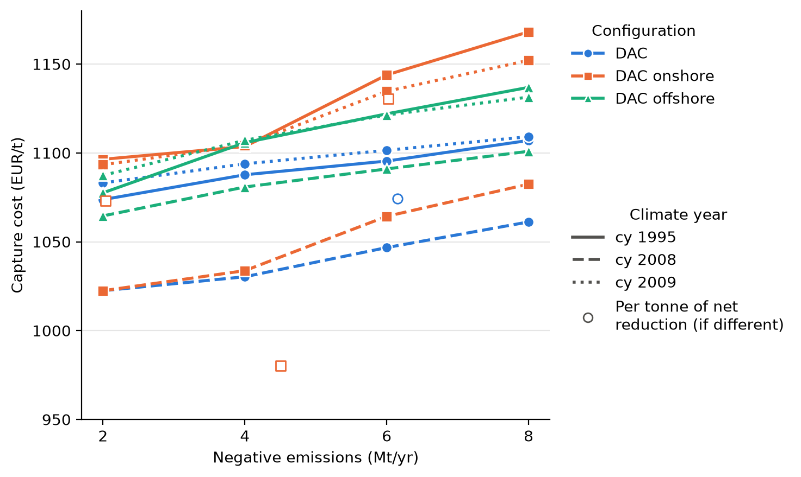
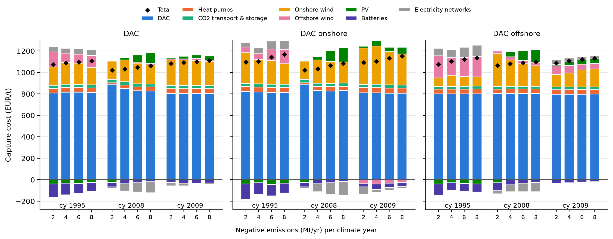
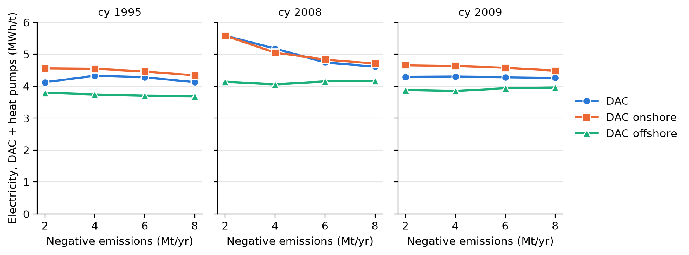

# 2040 capture costs: DAC, onshore-only and offshore-only (2–8 Mt)

*Generated by Claude, 2026-11-16. Data: `A:\ResearchData\DAC offshore\runs\results_emission_reduction_target\results\2040_1`
(39 runs: No DAC baseline + DAC / onshore-only / offshore-only × 2, 4, 6, 8 Mt × cy 1995, 2008, 2009).
All runs are `optimal`, gap 0, CO2 tax 189 EUR/t. Data and figures are in `emission_reduction_target/`.*

**Capture cost** = (`total_npv` of the run − `total_npv` of No DAC of the same climate year) / `emissions_neg`.
All targets are met exactly. Removals earn no CO2 price.

## 1. Key results

1. **Capture costs are 1,022–1,168 EUR/t.** About 800 EUR/t of that is the DAC unit itself, so the
   configurations and climate years differ by only ~150 EUR/t. That difference comes almost entirely
   from the **electricity supply** (87–292 EUR/t).
2. **Combining onshore and offshore DAC is always cheapest.** The benefit grows with the target: 0–4 EUR/t at
   2 Mt, 17–30 EUR/t at 6–8 Mt. At 8 Mt about half of the removal (4.1–4.3 Mt) is offshore in every
   climate year.
3. **Onshore DAC is limited by NO1.** NO1 is the only cheap onshore site: it has a large, good wind
   resource and the Norwegian hydro reservoir behind it (section 3.3). It is full at `size_max` = 3.8 Mt.
   Beyond ~4 Mt the onshore-only marginal cost jumps by 80–115 EUR/t (to 1,195–1,225 EUR/t), because the
   next sites (UK3, DK1, UK1) have no hydro and need offshore wind, links or PV. In 2009 most of that jump
   is the gas credit of the 4 Mt run disappearing (flag A), not a site effect.
4. **Offshore DAC needs less energy, but its electricity is more expensive.** It uses 3.7–4.2 MWh_el/t
   (onshore: 4.3–5.6 MWh_el/t), and its DAC unit costs up to ~20 EUR/t less per tonne. But each MWh it uses
   costs 48–73 EUR (onshore: 16–65 EUR). In 1995 and 2009 these effects roughly cancel at 2–4 Mt, and
   offshore wins above 4 Mt.
5. **cy 2008 is the exception.** No offshore wind is built in 2008, and NO1 curtails 66 TWh of onshore wind
   in the baseline. Onshore DAC at NO1 runs flexibly on this nearly free electricity (16 EUR/MWh at 2 Mt).
   So 2008 is the cheapest climate year (1,022 EUR/t), and offshore-only is 27–47 EUR/t more expensive
   than onshore-only up to 6 Mt (19 EUR/t at 8 Mt).
6. **Offshore DAC is now built next to offshore wind.** In 1995 and 2009, offshore DAC sits at the
   baseline's offshore wind nodes (NO_A, NO_B, DK_C, UK_I–UK_L), and offshore wind adds 50–205 EUR/t in
   the offshore-only runs.
7. **DAC barely uses curtailed electricity.** The baselines curtail 22–42 % of available VRE energy.
   But DAC runs as baseload, because its CAPEX is too high to idle it (section 3.4). So it is powered by
   new wind and PV, and 24–44 % of that new energy is curtailed as well. The only exception is cy 2008 at
   2 Mt.
8. **Batteries (and in 1995 PV) are a credit.** The wind built for DAC produces more than DAC needs in
   the evening peak, when the baseline relies on batteries. So every DAC run needs up to 6 % less
   battery capacity (−15 to −142 EUR/t). In 1995 it also replaces some PV (section 3.2).
9. **Per tonne of net reduction**, only four cy 2009 runs change, because their positive emissions fall
   below the baseline. The largest case is onshore-only at 4 Mt: 1,104 → 980 EUR/t (section 2.1).

## 2. Capture cost

*Figure 1: Average capture cost vs. No DAC, all climate years. Color/marker = configuration, line style =
climate year. Hollow markers: cost per tonne of net reduction where it differs (section 2.1), plotted at
the net reduction. In cy 2008 at 2 Mt, DAC and onshore-only are the same result (NO1 only), so the blue
point is hidden.*

- **cy 2008 is cheaper, mainly onshore.** cy 2008 is 46–64 EUR/t cheaper than 1995 and 2009 in the
  combined runs and 70–86 EUR/t in onshore-only, but only 13–36 EUR/t in offshore-only. The 2008
  advantage is the cheap curtailed wind at NO1, which only onshore DAC there can use.
- **1995 and 2009 are almost the same.** Their curves lie within 16 EUR/t of each other for every
  configuration.
- **Onshore-only has the steepest curve** (+59 to +72 EUR/t from 2 to 8 Mt), offshore-only is in
  between (+36 to +59 EUR/t), and the combined case is the flattest (+26 to +39 EUR/t).

| cy | Configuration | 2 Mt | 4 Mt | 6 Mt | 8 Mt | Marginal 0→2 → 2→4 → 4→6 → 6→8 |
|---|---|---|---|---|---|---|
| 1995 | DAC | **1,074** | **1,088** | **1,095** | **1,107** | 1,074 → 1,102 → 1,111 → 1,142 |
| 1995 | onshore only | 1,096 | 1,104 | 1,144 | 1,168 | 1,096 → 1,111 → **1,225** → 1,241 |
| 1995 | offshore only | 1,078 | 1,106 | 1,122 | 1,137 | 1,078 → 1,134 → 1,154 → 1,182 |
| 2008 | DAC | **1,022** | **1,030** | **1,047** | **1,061** | 1,022 → 1,038 → 1,080 → 1,104 |
| 2008 | onshore only | 1,022 | 1,034 | 1,064 | 1,082 | 1,022 → 1,045 → **1,125** → 1,137 |
| 2008 | offshore only | 1,065 | 1,081 | 1,091 | 1,101 | 1,065 → 1,097 → 1,111 → 1,131 |
| 2009 | DAC | **1,083** | **1,094** | **1,102** | **1,109** | 1,083 → 1,105 → 1,117 → 1,132 |
| 2009 | onshore only | 1,093 | 1,104\* | 1,135 | 1,152 | 1,093 → 1,115 → **1,195** → 1,204 |
| 2009 | offshore only | 1,087 | 1,107 | 1,121 | 1,131 | 1,087 → 1,127 → 1,150 → 1,162 |

*EUR/t CO2. \* contains a 72 EUR/t credit from lower gas use, see flag A.*

**Combined vs. the best single configuration (EUR/t saved):**

| | 2 Mt | 4 Mt | 6 Mt | 8 Mt | Offshore share of the combined removal (2 / 4 / 6 / 8 Mt) |
|---|---|---|---|---|---|
| cy 1995 | 4 | 16 | 27 | 30 | 63 % / 33 % / 35 % / 52 % |
| cy 2008 | 0 | 4 | 17 | 21 | 0 % / 7 % / 37 % / 53 % |
| cy 2009 | 4 | 10 | 19 | 22 | 49 % / 45 % / 44 % / 51 % |

The cost curves are convex (marginal > average, marginal rising) in every series. The combined case is
never more expensive than a single configuration, so the results are consistent.

### 2.1 Cost per tonne of net reduction

**Net reduction** = negative emissions + (positive emissions of No DAC − positive emissions of the
run). The cost per tonne of net reduction = (`total_npv` − `total_npv` of No DAC) / net reduction. In 32
of 36 runs, positive emissions equal the baseline, so the net cost is the same as the capture cost in
the table above. Four cy 2009 runs differ:

| Run (cy 2009) | Negative emissions (Mt) | Net reduction (Mt) | Capture cost (EUR/t) | Cost per t net reduction (EUR/t) |
|---|---|---|---|---|
| onshore only 2 Mt | 2.00 | 2.04 | 1,093 | 1,073 |
| onshore only 4 Mt | 4.00 | **4.51** | 1,104 | **980** |
| onshore only 6 Mt | 6.00 | 6.02 | 1,135 | 1,131 |
| DAC 6 Mt | 6.00 | 6.15 | 1,102 | 1,074 |

Neither metric isolates DAC in these runs:
- **Capture cost** puts the gas and carbon savings on the DAC tonnes, so it is too low (1,104 for
  onshore-only at 4 Mt instead of ~1,176 EUR/t without the 72 EUR/t credit).
- **Cost per tonne of net reduction** spreads the cost over the cheap gas displacement too. 980 EUR/t
  would make onshore-only 2009 at 4 Mt the cheapest run of all, cheaper even than cy 2008. That is
  clearly not a DAC result: the wind built for DAC also displaces gas at well below 1,000 EUR/t (it saves
  189 EUR/t carbon cost plus fuel).

Both views agree on all other 32 runs. For clean DAC cost curves, the four runs should be re-run with
positive emissions fixed to the baseline (flag A).

## 3. Where the cost comes from

*Figure 2: Additional annualised cost per tonne vs. No DAC, by group. Diamonds: total from the summary.
The h5 design costs match `cost_capex/opex_tecs/netws` of the summary to < 1 k EUR.*

| Component (EUR/t) | DAC | onshore only | offshore only | Driver |
|---|---|---|---|---|
| DAC unit | 804–891 | 805–891 | 797–804 | Annualised CAPEX + fixed OPEX / productivity. Baseload everywhere (captured / `max_out` 0.99–1.00) except NO1 in cy 2008 |
| Heat pumps | 14–46 | 14–48 | 42–44 | Seawater HP offshore (COP 1.68), air-source HP onshore (COP 1.42–1.55) |
| CO2 transport & storage | 27–31 | 30–31 | 24–27 | Mostly storage OPEX; pipelines 1–8 EUR/t |
| **Electricity supply, net** | **87–239** | **87–292** | **198–269** | New wind/PV and networks minus avoided batteries |
| of which batteries | −18 to −121 | −15 to −142 | −19 to −102 | Fewer batteries than in the baseline in every run |
| Imports + carbon cost | 0 (−15 in one run) | 0 to −72 | 0 | See flag A |

**The DAC unit is a fixed block.** At full load and offshore productivity it costs ~800 EUR/t. It costs
more where productivity is lower (NO1: ~820 EUR/t at 2 Mt in cy 1995) or where the unit doesn't run at
full load (NO1 in cy 2008: 891 EUR/t at 2 Mt). Section 3.4 explains why this forces baseload operation.

**Batteries and PV can be negative**, because the capture cost is the cost of the whole re-optimised
system minus the baseline, not only DAC's own supply. Section 3.2 explains why.

### 3.1 Electricity: how much DAC uses and what it costs

*Figures 3 and 4: Electricity used by DAC and its heat pumps per tonne, and the net cost of the
additional electricity supply (wind, PV, batteries, networks) per MWh of that use.*

| | DAC | onshore only | offshore only |
|---|---|---|---|
| Electricity, DAC + heat pumps (MWh_el/t), 1995 / 2009 | 4.1–4.3 | 4.3–4.7 | 3.7–4.0 |
| Electricity (MWh_el/t), 2008 | 4.6–5.6 | 4.7–5.6 | 4.1–4.2 |
| Electricity supply cost (EUR/MWh), 1995 / 2009 | 45–56 | 44–65 | 57–73 |
| Electricity supply cost (EUR/MWh), 2008 | 16–37 | 16–39 | 48–56 |

**Why offshore DAC uses less electricity.** The heat demand is ~4.8–5.1 MWh_th/t at all sites. Offshore,
the seawater heat pump has a fixed COP of 1.74 in the input (1.68 in the results). Onshore, the
air-source heat pump uses Carnot × 0.45 (1.42–1.55), and more of the heat comes from ohmic heating
(efficiency 0.97). So offshore DAC needs 0.5–0.8 MWh_el/t less in 1995 and 2009 (~30–45 EUR/t at 55–60 EUR/MWh). This
advantage comes from the heat pump assumption, not from offshore wind (flag C).

**Why offshore electricity costs more.** Offshore DAC needs new links or offshore wind at the DAC node.
In cy 1995, electricity networks add 71–106 EUR/t in the offshore-only runs and 41–81 EUR/t onshore-only.
In cy 2008 there is no offshore wind to connect to, and the offshore DAC sites (UK_D/E, NO_A/B, NO_ST1/2)
are supplied with onshore wind and PV through the grid.

### 3.2 Why batteries and PV contribute negatively

| EUR/t | cy 1995 | cy 2008 | cy 2009 |
|---|---|---|---|
| Batteries | −72 to −142 | −15 to −73 | −19 to −51 |
| PV | −26 to −44 | −25 to −28 at 2 Mt, +20 to +131 above | +14 to +62 |
| Baseline battery capacity (GWh, 3 h batteries) | 205 | 189 | 135 |
| Battery capacity change in the DAC runs (GWh) | −3 to −13 | −2 to −4 | −1 to −6 |

**Batteries: the wind built for DAC covers part of the evening peak.** The baseline uses its 3-hour
batteries mainly as evening peak capacity: average discharge is 16–23 GW at 18:00, against 0.3 GW at
noon. In the 200 hours with the highest baseline battery discharge:
- in 1995 and 2009, the new wind built for the DAC runs produces 2–18 % *more* than its annual average
  (evening and winter wind); in 2008 it produces about its average,
- DAC and its heat pumps draw 4–12 % *less* than their average (the DAC performance depends on the
  weather, and output is lower in cool evening hours).

So the "DAC package" (DAC + the wind built for it) is a net exporter in exactly the hours that size the
batteries. In cy 1995 that's +0.15 to +0.6 GW, and battery discharge in those hours drops by 0.5–2.4 GW.
Battery *energy* throughput barely changes (−2.4 to +0.6 TWh/yr, ≤ 5 %, in the runs checked), so the
credit is for peak capacity, not for energy shifting. The capacity is removed spread over the system (NL4, NO_A, BE2, UK4,
NL2), partly offset by more batteries elsewhere (BE1, DE4), so it's a re-optimisation of the whole
battery fleet. A battery costs ~54 k EUR per MWh and year (397 EUR/kWh, 30 years, 27 % fixed OPEX), so
removing 4 GWh is worth ~220 M EUR/yr, or ~110 EUR/t at 2 Mt. That's why the credit is so large per tonne
at low targets and shrinks at 8 Mt.

In cy 2008 and 2009 the DAC package is roughly balanced in the peak hours (−1.3 to +0.0 GW), so the
battery credit is smaller.

**PV: in cy 1995, PV + batteries are replaced by wind.** The 1995 baseline relies more on PV
(96 GW, vs. 75–82 GW in 2008/2009) and batteries, because onshore wind is weakest in 1995 (mean CF
0.33). Where batteries are removed (UK4, BE2), PV goes too (−1 to −5 GW in total): the PV + battery
combination that served the evening is replaced by the evening surplus of the DAC wind. In cy 2008
(above 2 Mt) and cy 2009, the good wind sites are used up faster (NO1 full, NL nodes limited to
4–15 GW), so the DAC runs *add* PV (up to +17 GW in 2008 at 8 Mt, mostly DE4 and UK4), and PV becomes a
cost.

**What this means.** The battery and PV credits are a real system effect, but they are not specific to
DAC. Any flat load supplied by new wind would get a similar credit. They also depend on how the baseline
provides peak capacity: with cheaper batteries or more dispatchable capacity in the baseline, the credit
and the apparent advantage of the DAC runs in 1995 would shrink.

### 3.3 Why NO1 is cheap and the other onshore nodes are not

None of the onshore nodes has CO2 storage (all storage is offshore), so CO2 transport and storage cost
the same everywhere (~30 EUR/t). The difference is electricity:

| | NO1 | DK1 | UK3 | Other onshore nodes |
|---|---|---|---|---|
| Onshore wind CF 1995 / 2008 / 2009 | **0.39** / 0.36 / 0.38 | 0.39 / 0.43 / 0.41 | 0.27 / 0.33 / 0.31 | 0.24–0.44 |
| Onshore wind potential (GW) | **100** | 78 | 100 | 4–100 (NL 4–19, BE 4–6) |
| Hydro output in the baseline (TWh/yr) | **148–163** (reservoir 90 TWh) | 0 | 0 | only DE4 (small) |
| Baseline curtailment at the node (TWh/yr), 1995 / 2008 / 2009 | 24 / **66** / 16 | – | – | UK4 69 in 2008 |
| Mean temperature (°C) | **−0.2** (worst) | 8.2 | 6.1 | 6–11 |
| Air-source heat pump COP | **1.44** (worst) | 1.53 | 1.50 | – |

*Figures from the input data (`ClimateData.csv`, `Technologies.json`) and the baseline results.*

**NO1 is cheap despite the worst climate for DAC.** Its cold climate costs ~20 EUR/t on the DAC unit
(822 vs. ~800 EUR/t offshore) and makes the heat pumps the least efficient. It still wins because of
its electricity:

1. **Large, good wind resource.** In 1995 NO1 has the best onshore wind CF (0.39) and 100 GW potential.
   DAC at NO1 is mostly supplied by new wind at NO1 (+0.7 to +2.3 GW), which provides 48–78 % of the DAC
   electricity at 2 Mt. The rest comes through the grid.
2. **Hydro behind it.** NO1 is the Norwegian hydro system (~150–160 TWh/yr output, 90 TWh reservoir). Over
   the year the hydro output doesn't change with DAC (it's limited by the inflow), but hydro and imports
   balance the hours when NO1 wind is low. NO1 doesn't need any new batteries for DAC (Δ battery ≤ 0.3 GWh).
3. **Curtailed wind in 2008.** In 2008 the baseline curtails 66 TWh at NO1. Onshore DAC at NO1 cuts the
   NO1 curtailment by 8.6 TWh at 2 Mt and even *removes* 0.6 GW of NO1 wind. Its electricity costs only
   16 EUR/MWh. That's why NO1 is the first choice in 2008 although its wind CF (0.36) is lower than
   DK1, NL and UK that year.

**The next nodes lack both.** NO1 is full at `size_max` = 3.8 Mt (~3.9 Mt captured). What the next
2 Mt cost in the onshore-only runs (marginal cost by component, EUR/t):

| Step (onshore only) | Where | DAC | Onshore wind | Offshore wind | PV | Batteries | Networks | Total |
|---|---|---|---|---|---|---|---|---|
| 1995, 2→4 Mt | NO1 | 814 | 163 | 59 | −18 | −74 | 71 | **1,111** |
| 1995, 4→6 Mt | UK3 | 801 | 210 | **217** | −75 | −103 | **108** | **1,225** |
| 2008, 2→4 Mt | NO1 | 772 | 264 | 0 | 87 | −35 | −131 | **1,045** |
| 2008, 4→6 Mt | DK1, UK3 | 822 | 177 | 0 | **239** | −4 | −179 | **1,125** |

*Heat pumps, CO2 transport & storage and other technologies (~70–90 EUR/t together) are in the total.
2009 is left out because the gas credit (flag A) distorts its steps.*

- **UK3 (1995, 2009)** has a poor onshore wind CF (0.27–0.31), and it's the shore node of the UK offshore
  hubs (links to UK_D 7 GW, UK_E 4 GW, new UK_K link). Its DAC is supplied with offshore wind plus new
  links (+325 EUR/t together), against 130 EUR/t at NO1. Its DAC unit is cheaper than NO1's (milder
  climate), but that doesn't make up for the electricity.
- **DK1 and UK3 (2008)** are supplied with PV (+239 EUR/t) and need more DAC capacity per tonne than the
  last NO1 step. PV only delivers at midday, so it needs more capacity per MWh of baseload.
- **Wind alone doesn't explain it.** Onshore wind has the same cost at every node (1.47 M EUR/MW). In the
  1995 and 2008 baselines the model builds no onshore wind at all at DK1, UK3 or the NL nodes, although
  DK1 and NL have a similar or better CF, but 49–54 GW at NO1 (with only 13 % curtailed in 1995). Without
  hydro to firm it, a wind MWh is worth much less at these nodes, for DAC as for demand. Why UK3 and DK1
  are chosen before the NL nodes (better CF, 4–19 GW potential, unused in the 1995/2008 baselines) isn't
  clear from these numbers. My guess is network position (UK3 is an offshore hub), but I haven't
  verified it.

### 3.4 Why DAC runs as baseload and doesn't reduce curtailment

| | cy 1995 | cy 2008 | cy 2009 |
|---|---|---|---|
| Baseline VRE curtailed (TWh/yr) | 103 | 143 | 97 |
| Share of available VRE energy | 22 % | 42 % | 30 % |
| Largest curtailing units | NO_A offshore wind 51 TWh (41 %), NO1 onshore 24 TWh | UK4 onshore 69 TWh (64 %), NO1 onshore 66 TWh (42 %) | NO1 onshore 16 TWh, UK_K offshore 12 TWh (50 %) |
| Share of DAC electricity that baseline curtailment could cover, same node / anywhere (2 Mt runs) | 16–43 % / 67–69 % | 0–79 % / 80–81 % | 23–25 % / 60–63 % |
| Hours in which system-wide curtailment ≥ DAC demand (2 / 8 Mt) | 53–55 % / 45–47 % | 62–72 % / 49–50 % | 48–54 % / 41–42 % |
| Change in curtailment, 8 Mt runs (TWh/yr) | +12 to +16 | +13 to +24 | +10 to +15 |
| Share of new VRE energy curtailed, 8 Mt runs | 29–33 % | 28–44 % | 24–32 % |

*"Anywhere" assumes the curtailed electricity could be moved without network limits, so it's an upper
bound.*

**Why baseload: the DAC CAPEX is too large to leave idle.** A DAC unit costs 841 EUR per t/yr of
capacity and year (5,673 EUR/(t/yr), 10 %, 25 years, 34.6 % fixed OPEX), or ~800 EUR/t at full load. At
load factor L it costs 800/L EUR/t. Electricity is only 4.1–4.7 MWh/t × 45–73 EUR/MWh = 190–340 EUR/t.
So even if electricity were *free* in the remaining hours, it would only pay to reduce the load to
L = 800/(800 + 340) ≈ 0.70–0.81. Running DAC only when curtailment covers its demand (41–72 % of the
hours) would raise the DAC unit cost to 1,100–1,950 EUR/t. And curtailed electricity is not free to
reach. Where it occurs at the same node, it covers only 0–43 % of DAC demand (except NO1 in 2008); the
rest needs network capacity. So the optimum is to run at full output almost always: captured /
maximum output is 0.99–1.00, with only 20–60 hours below half load per year.

**Why curtailment goes up.** A baseload consumer has to be supplied in calm hours too, so the model
builds enough new wind (plus some PV) to cover DAC over the year. In windy hours this new wind produces
more than DAC needs. Those are largely the same hours in which the baseline already curtails (wind is correlated across the
North Sea region), so about a third of the new energy is curtailed again (24–44 %).
It still pays: onshore wind at ~62 EUR/MWh with a third curtailed costs ~90 EUR/MWh of used energy.
Minus the battery and PV credits (3.2), that gives the 45–73 EUR/MWh net electricity cost. Firm
alternatives (more batteries, or using the existing curtailment via links) are more expensive.

**The exception: cy 2008 at 2 Mt (NO1).** Here the baseline curtailment is *at* the DAC node (66 TWh)
and covers 79 % of DAC demand. DAC uses it: system curtailment drops by 3.2 TWh (NO1: −8.6 TWh), DAC
runs below half load in 1,144 h, uses 4.2 MWh_el/t of ohmic heating (cheap to install, flag B), and
builds ~10 % more capacity than it uses (captured / maximum output 0.90). That costs +90 EUR/t on the DAC
unit (891 vs. ~805 EUR/t), but the electricity is so cheap (16 EUR/MWh) that it saves more. From 4 Mt on,
NO1 is full and DAC runs as baseload again.

## 4. Where DAC is built

| | cy 1995 | cy 2008 | cy 2009 |
|---|---|---|---|
| DAC, 2 Mt | NO1 0.7 + NO_A, NO_B, UK_K (0.4 each) | NO1 2.0 | NO1 1.0 + UK_K, NO_B (0.4) |
| DAC, 8 Mt | NO1 3.9 + 11 offshore nodes | NO1 3.7 + 11 offshore nodes | NO1 3.9 + 11 offshore nodes |
| Onshore only, 8 Mt | NO1 3.9, UK3 2.8, UK1 1.3 | NO1 3.8, DK1 3.2, UK3 1.1 | NO1 3.9, UK3 2.8, DK1 1.3 |
| Offshore only, 8 Mt | 20 nodes | 20 nodes | 19 nodes |

*Mt/yr captured. Offshore DAC units are always at `size_max` = 0.4 Mt (0.42 Mt captured).*

- **Offshore DAC goes to the offshore wind nodes first** in 1995 (NO_A, NO_B, DK_C, UK_K, UK_L) and 2009
  (UK_I–UK_L, NO_A, NO_B). In 2008 (no offshore wind) it goes to UK_D/UK_E and NO_A/NO_B instead, which
  are close to NO1 and the UK grid.
- **Offshore wind follows DAC in 1995.** Offshore-only adds +1.8 to +6.7 GW offshore wind (+5.5 to
  +20.7 TWh). In cy 2009 it adds +0.7 to +1.8 GW, and in cy 2008 at most +1 GW.
- **Many small offshore sites.** 8 Mt offshore needs 19–20 nodes at `size_max`. If 0.4 Mt per node is
  conservative, the offshore cost curve would be flatter (fewer, better sites).

## 5. Flags

**A. Positive emissions fall below the baseline in four cy 2009 runs.** The constraint is
`emissions_pos ≤ baseline`, and in these runs it doesn't bind:

| Run (cy 2009) | Δ positive emissions (Mt) | Imports + carbon cost (EUR/t) |
|---|---|---|
| onshore only 2 Mt | −0.04 | −10 |
| onshore only 4 Mt | **−0.51** | **−72** |
| onshore only 6 Mt | −0.02 | −2 |
| DAC 6 Mt | −0.15 | −15 |

The extra wind built for DAC replaces 1.7 TWh of gas
generation in onshore-only 4 Mt. The capture cost credits the saved gas and carbon cost to DAC, so the
2009 onshore-only 4 Mt value (1,104 EUR/t) is ~70 EUR/t too low compared with the other runs. Without the
credit it would be above offshore-only (1,107). Its electricity cost (63 EUR/MWh in Fig. 4) is high for
the same reason: wind was built to replace gas, not only for DAC. These runs make the onshore-only 2009
curve uneven (marginal 1,115 → 1,195). The cost per tonne of *net* reduction (section 2.1) goes too far
the other way (980 EUR/t). Recommendation: re-run these four cases with `emissions_pos` fixed to the
baseline (equality).

**B. cy 2008 relies on ohmic heating without its own CAPEX.** At NO1 (2 Mt), 4.2 of the 4.9 MWh_el/t of
DAC electricity is ohmic heating. Heat pumps then cost only 14 EUR/t instead of ~45. This is what makes
2008 the cheapest year at low targets. Whether that's realistic depends on whether the DAC CAPEX includes
an electric heater sized for the full heat demand.

**C. The offshore DAC advantage rests on input assumptions.**
- Onshore and offshore DAC have **identical cost data** (5,673 EUR/(t/yr), 34.6 % fixed OPEX). There is no
  platform, installation or O&M premium offshore. With +10 % CAPEX offshore (~+80 EUR/t), offshore-only
  would be more expensive than onshore-only in every run, and the combined case would use much less
  offshore DAC.
- The **seawater heat pump has a fixed COP of 1.74** (T_in 7 °C, T_out 120 °C, about 50 % of Carnot). The
  onshore air-source heat pump uses 45 % of Carnot at ambient temperature. That's worth ~30–50 EUR/t for
  offshore DAC. It's worth checking that both use the same efficiency basis.
- Offshore DAC productivity is slightly higher (milder climate), worth ~10–20 EUR/t on the DAC unit.

**D. The baselines curtail a lot.** 22–42 % of available VRE energy is curtailed in cost-optimal
baselines, with 64 % for new onshore wind at UK4 in cy 2008. It may be real (transmission bottlenecks,
no other flexibility), but it's high enough to sanity-check `cap_factor` and the UK4/NO1 export capacity.
It matters for DAC because it sets the "cheap electricity" story in cy 2008.

**E. Results differ by only a few EUR/t in places.** Barrier without crossover, and near-equivalent
choices (batteries vs. wind, gas vs. wind in flag A), move individual components by tens of EUR/t between
neighbouring runs. Treat differences < ~5 EUR/t as ties, e.g. onshore vs. offshore at 4 Mt in 1995
(1,104 vs. 1,106) and 2009 (1,104\* vs. 1,107).

**F. Data handling.**
- Each `<cy>/No_DAC/Summary.xlsx` still has the old 2026-11-11 baseline row next to the new one, and the
  old result folder isn't there. `concat_summaries.py` now keeps only the latest run per case.
- CO2 pipeline arcs are stored **once** in the h5 file, electricity arcs **twice**. The cost breakdown
  previously halved both (`plot_capture_costs.py`), which under-counted pipelines by up to ~8 EUR/t. Fixed.

**What looks fine:**
- **Penalties.** Baselines and target runs now carry the same storage and flow penalties
  (`ub − total_npv` = 15.3–17.3 M EUR in all runs of a climate year, differences ≤ 0.15 M EUR). So they
  don't distort the capture cost.
- **Circulation.** Circulating flows are negligible: ≤ 37 GWh electricity (< 0.003 % of arc flow) and
  ≤ 1,700 t CO2 per year.
- **CO2 storage.** Injection uses only 0.8–3 % of the injection capacity, so storage is not a limit at
  these targets.

## 6. Code

In `dac_offshore/claude_quick_analysis` (set `QA_ROOT_PATH` to the results folder and `QA_OUTPUT_DIR` to
`emission_reduction_target`; the defaults are the old folders):

| Script | Output |
|---|---|
| `concat_summaries.py` | `data/Summary_2040_processed.csv` (now drops older duplicate runs) |
| `extract_design_costs.py` (new) | `data/design_costs.csv`: size and annualised cost per technology and arc |
| `extract_node_operation.py` (new) | `data/node_operation.csv`: annual operation per node and technology, DAC part-load hours |
| `extract_run_metrics.py` | `data/run_metrics.csv`: flows, circulation, curtailment, storage utilisation (needs repo root on `PYTHONPATH`) |
| `extract_hourly_operation.py` (new) | `data/hourly/<case>.npz`: hourly operation per node and technology group (baselines, 2 and 8 Mt runs) |
| `plot_emission_reduction_target.py` (new) | Figures 1–4, `data/capture_cost_by_group.csv` (incl. cost per tonne of net reduction) |
| `data/electricity_deltas.csv`, `data/dac_sites.csv`, `data/curtailment_coverage.csv`, `data/node_characteristics.csv` | Generation, curtailment, DAC sites, curtailment coverage and node inputs per run (made interactively for this report) |
