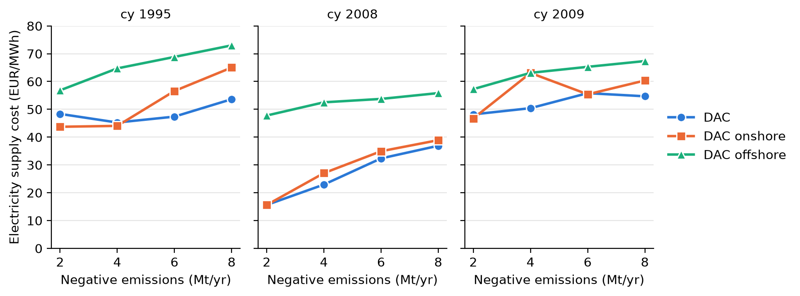

# 2040 capture costs: DAC, onshore-only and offshore-only (2–8 Mt)

*Generated by Claude, 2026-11-16. Data: `A:\ResearchData\DAC offshore\runs\results_emission_reduction_target\results\2040_1`
(39 runs: No DAC baseline + DAC / onshore-only / offshore-only × 2, 4, 6, 8 Mt × cy 1995, 2008, 2009).
All runs are `optimal`, gap 0, CO2 tax 189 EUR/t. Data and figures are in `emission_reduction_target/`.*

**Capture cost** = (`total_npv` of the run − `total_npv` of No DAC of the same climate year) / `emissions_neg`.
All targets are met exactly. Removals earn no CO2 price.

## 1. Key results

1. **Capture costs are 1,022–1,168 EUR/t.** About 800 EUR/t of that is the DAC unit itself, so the
   configurations and climate years differ by only ~150 EUR/t. That difference comes almost entirely
   from the **electricity supply** (87–292 EUR/t).
2. **Combining onshore and offshore DAC is always cheapest.** The benefit grows with the target: 0–4 EUR/t at
   2 Mt, 17–30 EUR/t at 6–8 Mt. At 8 Mt about half of the removal (4.1–4.3 Mt) is offshore in every
   climate year.
3. **Onshore DAC is limited by NO1.** NO1 is the only cheap onshore site, and it is full at
   `size_max` = 3.8 Mt. Beyond ~4 Mt the onshore-only marginal cost jumps by 80–115 EUR/t (to
   1,195–1,225 EUR/t), because the next sites (UK3, DK1, UK1) are worse.
4. **Offshore DAC needs less energy, but its electricity is more expensive.** It uses 3.7–4.2 MWh_el/t
   (onshore: 4.3–5.6 MWh_el/t), and its DAC unit costs up to ~20 EUR/t less per tonne. But each MWh it uses
   costs 48–73 EUR (onshore: 16–65 EUR). In 1995 and 2009 these effects roughly cancel at 2–4 Mt, and
   offshore wins above 4 Mt.
5. **cy 2008 is the exception.** No offshore wind is built in 2008, and NO1 curtails 66 TWh of onshore wind
   in the baseline. Onshore DAC at NO1 runs flexibly on this nearly free electricity (16 EUR/MWh at 2 Mt).
   So 2008 is the cheapest climate year (1,022 EUR/t), and offshore-only is 27–47 EUR/t more expensive
   than onshore-only up to 6 Mt (19 EUR/t at 8 Mt).
6. **Offshore DAC is now built next to offshore wind.** In 1995 and 2009, offshore DAC sits at the
   baseline's offshore wind nodes (NO_A, NO_B, DK_C, UK_I–UK_L), and offshore wind adds 50–205 EUR/t in
   the offshore-only runs.
7. **DAC barely uses curtailed electricity.** The baselines curtail 22–42 % of available VRE energy.
   But DAC runs as baseload, so it is powered by new wind and PV, and 24–44 % of that new energy is
   curtailed as well. The only exception is cy 2008 at 2 Mt.

## 2. Capture cost

*Figure 1: Average capture cost vs. No DAC. In cy 2008 at 2 Mt, DAC and onshore-only are the same run
result (NO1 only), so the blue point is hidden.*

| cy | Configuration | 2 Mt | 4 Mt | 6 Mt | 8 Mt | Marginal 0→2 → 2→4 → 4→6 → 6→8 |
|---|---|---|---|---|---|---|
| 1995 | DAC | **1,074** | **1,088** | **1,095** | **1,107** | 1,074 → 1,102 → 1,111 → 1,142 |
| 1995 | onshore only | 1,096 | 1,104 | 1,144 | 1,168 | 1,096 → 1,111 → **1,225** → 1,241 |
| 1995 | offshore only | 1,078 | 1,106 | 1,122 | 1,137 | 1,078 → 1,134 → 1,154 → 1,182 |
| 2008 | DAC | **1,022** | **1,030** | **1,047** | **1,061** | 1,022 → 1,038 → 1,080 → 1,104 |
| 2008 | onshore only | 1,022 | 1,034 | 1,064 | 1,082 | 1,022 → 1,045 → **1,125** → 1,137 |
| 2008 | offshore only | 1,065 | 1,081 | 1,091 | 1,101 | 1,065 → 1,097 → 1,111 → 1,131 |
| 2009 | DAC | **1,083** | **1,094** | **1,102** | **1,109** | 1,083 → 1,105 → 1,117 → 1,132 |
| 2009 | onshore only | 1,093 | 1,104\* | 1,135 | 1,152 | 1,093 → 1,115 → **1,195** → 1,204 |
| 2009 | offshore only | 1,087 | 1,107 | 1,121 | 1,131 | 1,087 → 1,127 → 1,150 → 1,162 |

*EUR/t CO2. \* contains a 72 EUR/t credit from lower gas use, see flag A.*

**Combined vs. the best single configuration (EUR/t saved):**

| | 2 Mt | 4 Mt | 6 Mt | 8 Mt | Offshore share of the combined removal (2 / 4 / 6 / 8 Mt) |
|---|---|---|---|---|---|
| cy 1995 | 4 | 16 | 27 | 30 | 63 % / 33 % / 35 % / 52 % |
| cy 2008 | 0 | 4 | 17 | 21 | 0 % / 7 % / 37 % / 53 % |
| cy 2009 | 4 | 10 | 19 | 22 | 49 % / 45 % / 44 % / 51 % |

The cost curves are convex (marginal > average, marginal rising) in every series. The combined case is
never more expensive than a single configuration, so the results are consistent.

## 3. Where the cost comes from

*Figure 2: Additional annualised cost per tonne vs. No DAC, by group. Diamonds: total from the summary.
The h5 design costs match `cost_capex/opex_tecs/netws` of the summary to < 1 k EUR.*

| Component (EUR/t) | DAC | onshore only | offshore only | Driver |
|---|---|---|---|---|
| DAC unit | 804–891 | 805–891 | 797–804 | Annualised CAPEX + fixed OPEX / productivity. Baseload everywhere (captured / `max_out` 0.99–1.00) except NO1 in cy 2008 |
| Heat pumps | 14–46 | 14–48 | 42–44 | Seawater HP offshore (COP 1.68), air-source HP onshore (COP 1.42–1.55) |
| CO2 transport & storage | 27–31 | 30–31 | 24–27 | Mostly storage OPEX; pipelines 1–8 EUR/t |
| **Electricity supply, net** | **87–239** | **87–292** | **198–269** | New wind/PV and networks minus avoided batteries |
| of which batteries | −18 to −121 | −15 to −142 | −19 to −102 | Fewer batteries than in the baseline in every run |
| Imports + carbon cost | 0 (−15 in one run) | 0 to −72 | 0 | See flag A |

**The DAC unit is a fixed block.** At full load and offshore productivity it costs ~800 EUR/t. It costs
more where productivity is lower (NO1: ~820 EUR/t at 2 Mt in cy 1995) or where the unit doesn't run at
full load (NO1 in cy 2008: 891 EUR/t at 2 Mt). Because the DAC unit is ~75 % of the cost, it pays to run
DAC as baseload. A unit at 50 % load would add ~800 EUR/t of CAPEX. The cheapest electricity can't save
that much (electricity supply is only 87–292 EUR/t).

**Batteries are always a credit.** Every DAC run builds 1–13 GW fewer batteries than the baseline. In
cy 1995 that saves 72–142 EUR/t. The extra wind built for DAC (+2 to +12 GW) also covers hours that the
baseline served from batteries. This is a real system effect, but it means part of the "electricity
supply" cost is a re-optimisation of the baseline rather than DAC's own supply.

### 3.1 Electricity: how much DAC uses and what it costs

*Figures 3 and 4: Electricity used by DAC and its heat pumps per tonne, and the net cost of the
additional electricity supply (wind, PV, batteries, networks) per MWh of that use.*

| | DAC | onshore only | offshore only |
|---|---|---|---|
| Electricity, DAC + heat pumps (MWh_el/t), 1995 / 2009 | 4.1–4.3 | 4.3–4.7 | 3.7–4.0 |
| Electricity (MWh_el/t), 2008 | 4.6–5.6 | 4.7–5.6 | 4.1–4.2 |
| Electricity supply cost (EUR/MWh), 1995 / 2009 | 45–56 | 44–65 | 57–73 |
| Electricity supply cost (EUR/MWh), 2008 | 16–37 | 16–39 | 48–56 |

**Why offshore DAC uses less electricity.** The heat demand is ~4.8–5.1 MWh_th/t at all sites. Offshore,
the seawater heat pump has a fixed COP of 1.74 in the input (1.68 in the results). Onshore, the
air-source heat pump uses Carnot × 0.45 (1.42–1.55), and more of the heat comes from ohmic heating
(efficiency 0.97). So offshore DAC needs 0.5–0.8 MWh_el/t less in 1995 and 2009 (~30–45 EUR/t at 55–60 EUR/MWh). This
advantage comes from the heat pump assumption, not from offshore wind (flag C).

**Why offshore electricity costs more.** Offshore DAC needs new links or offshore wind at the DAC node.
In cy 1995, electricity networks add 71–106 EUR/t in the offshore-only runs and 41–81 EUR/t onshore-only.
In cy 2008 there is no offshore wind to connect to, and the offshore DAC sites (UK_D/E, NO_A/B, NO_ST1/2)
are supplied with onshore wind and PV through the grid.

**Why onshore gets expensive above 4 Mt.** NO1 is full at ~3.9 Mt captured. In 1995 and 2009 the next
site is UK3, and the onshore-only electricity cost rises from ~44–47 to 55–65 EUR/MWh. In 2008 the next
sites are DK1 and UK3.

### 3.2 Curtailment

| | cy 1995 | cy 2008 | cy 2009 |
|---|---|---|---|
| Baseline VRE curtailed (TWh/yr) | 103 | 143 | 97 |
| Share of available VRE energy | 22 % | 42 % | 30 % |
| Largest curtailing units | NO_A offshore wind 51 TWh (41 %), NO1 onshore 24 TWh | UK4 onshore 69 TWh (64 %), NO1 onshore 66 TWh (42 %) | NO1 onshore 16 TWh, UK_K offshore 12 TWh (50 %) |
| Change in curtailment, 8 Mt runs (TWh/yr) | +12 to +16 | +13 to +24 | +10 to +15 |
| Share of new VRE energy curtailed, 8 Mt runs | 29–33 % | 28–44 % | 24–32 % |

- **DAC adds curtailment instead of absorbing it.** Curtailment happens in 66–80 % of all hours (also in
  the baseline), but it doesn't line up with a baseload consumer. DAC is therefore powered by new
  capacity, about a third of whose output is curtailed again. That roughly sets the electricity cost of
  45–73 EUR/MWh.
- **The exception is cy 2008 at 2 Mt (NO1).** Curtailment goes *down* by 3.2 TWh. DAC runs below half load
  in 1,144 h, takes 4.2 MWh_el/t as ohmic heating, and builds ~10 % more capacity than it uses (captured / maximum output 0.90). The
  electricity is so cheap (16 EUR/MWh) that this pays even with the higher DAC unit cost (891 vs.
  ~805 EUR/t). From 4 Mt on, NO1 is full and DAC runs as baseload again.

## 4. Where DAC is built

| | cy 1995 | cy 2008 | cy 2009 |
|---|---|---|---|
| DAC, 2 Mt | NO1 0.7 + NO_A, NO_B, UK_K (0.4 each) | NO1 2.0 | NO1 1.0 + UK_K, NO_B (0.4) |
| DAC, 8 Mt | NO1 3.9 + 11 offshore nodes | NO1 3.7 + 11 offshore nodes | NO1 3.9 + 11 offshore nodes |
| Onshore only, 8 Mt | NO1 3.9, UK3 2.8, UK1 1.3 | NO1 3.8, DK1 3.2, UK3 1.1 | NO1 3.9, UK3 2.8, DK1 1.3 |
| Offshore only, 8 Mt | 20 nodes | 20 nodes | 19 nodes |

*Mt/yr captured. Offshore DAC units are always at `size_max` = 0.4 Mt (0.42 Mt captured).*

- **Offshore DAC goes to the offshore wind nodes first** in 1995 (NO_A, NO_B, DK_C, UK_K, UK_L) and 2009
  (UK_I–UK_L, NO_A, NO_B). In 2008 (no offshore wind) it goes to UK_D/UK_E and NO_A/NO_B instead, which
  are close to NO1 and the UK grid.
- **Offshore wind follows DAC in 1995.** Offshore-only adds +1.8 to +6.7 GW offshore wind (+5.5 to
  +20.7 TWh). In cy 2009 it adds +0.7 to +1.8 GW, and in cy 2008 at most +1 GW.
- **Many small offshore sites.** 8 Mt offshore needs 19–20 nodes at `size_max`. If 0.4 Mt per node is
  conservative, the offshore cost curve would be flatter (fewer, better sites).

## 5. Flags

**A. Positive emissions fall below the baseline in four cy 2009 runs.** The constraint is
`emissions_pos ≤ baseline`, and in these runs it doesn't bind:

| Run (cy 2009) | Δ positive emissions (Mt) | Imports + carbon cost (EUR/t) |
|---|---|---|
| onshore only 2 Mt | −0.04 | −10 |
| onshore only 4 Mt | **−0.51** | **−72** |
| onshore only 6 Mt | −0.02 | −2 |
| DAC 6 Mt | −0.15 | −15 |

The extra wind built for DAC replaces 1.7 TWh of gas
generation in onshore-only 4 Mt. The capture cost credits the saved gas and carbon cost to DAC, so the
2009 onshore-only 4 Mt value (1,104 EUR/t) is ~70 EUR/t too low compared with the other runs. Without the
credit it would be above offshore-only (1,107). Its electricity cost (63 EUR/MWh in Fig. 4) is high for
the same reason: wind was built to replace gas, not only for DAC. These runs make the onshore-only 2009
curve uneven (marginal 1,115 → 1,195). Options: fix `emissions_pos` to the baseline (equality), or
report the cost per tonne of *net* emission reduction (4.51 Mt instead of 4 Mt for this run).

**B. cy 2008 relies on ohmic heating without its own CAPEX.** At NO1 (2 Mt), 4.2 of the 4.9 MWh_el/t of
DAC electricity is ohmic heating. Heat pumps then cost only 14 EUR/t instead of ~45. This is what makes
2008 the cheapest year at low targets. Whether that's realistic depends on whether the DAC CAPEX includes
an electric heater sized for the full heat demand.

**C. The offshore DAC advantage rests on input assumptions.**
- Onshore and offshore DAC have **identical cost data** (5,673 EUR/(t/yr), 34.6 % fixed OPEX). There is no
  platform, installation or O&M premium offshore. With +10 % CAPEX offshore (~+80 EUR/t), offshore-only
  would be more expensive than onshore-only in every run, and the combined case would use much less
  offshore DAC.
- The **seawater heat pump has a fixed COP of 1.74** (T_in 7 °C, T_out 120 °C, about 50 % of Carnot). The
  onshore air-source heat pump uses 45 % of Carnot at ambient temperature. That's worth ~30–50 EUR/t for
  offshore DAC. It's worth checking that both use the same efficiency basis.
- Offshore DAC productivity is slightly higher (milder climate), worth ~10–20 EUR/t on the DAC unit.

**D. The baselines curtail a lot.** 22–42 % of available VRE energy is curtailed in cost-optimal
baselines, with 64 % for new onshore wind at UK4 in cy 2008. It may be real (transmission bottlenecks,
no other flexibility), but it's high enough to sanity-check `cap_factor` and the UK4/NO1 export capacity.
It matters for DAC because it sets the "cheap electricity" story in cy 2008.

**E. Results differ by only a few EUR/t in places.** Barrier without crossover, and near-equivalent
choices (batteries vs. wind, gas vs. wind in flag A), move individual components by tens of EUR/t between
neighbouring runs. Treat differences < ~5 EUR/t as ties, e.g. onshore vs. offshore at 4 Mt in 1995
(1,104 vs. 1,106) and 2009 (1,104\* vs. 1,107).

**F. Data handling.**
- Each `<cy>/No_DAC/Summary.xlsx` still has the old 2026-11-11 baseline row next to the new one, and the
  old result folder isn't there. `concat_summaries.py` now keeps only the latest run per case.
- CO2 pipeline arcs are stored **once** in the h5 file, electricity arcs **twice**. The cost breakdown
  previously halved both (`plot_capture_costs.py`), which under-counted pipelines by up to ~8 EUR/t. Fixed.

**What looks fine:**
- **Penalties.** Baselines and target runs now carry the same storage and flow penalties
  (`ub − total_npv` = 15.3–17.3 M EUR in all runs of a climate year, differences ≤ 0.15 M EUR). So they
  don't distort the capture cost.
- **Circulation.** Circulating flows are negligible: ≤ 37 GWh electricity (< 0.003 % of arc flow) and
  ≤ 1,700 t CO2 per year.
- **CO2 storage.** Injection uses only 0.8–3 % of the injection capacity, so storage is not a limit at
  these targets.

## 6. Code

In `dac_offshore/claude_quick_analysis` (set `QA_ROOT_PATH` to the results folder and `QA_OUTPUT_DIR` to
`emission_reduction_target`; the defaults are the old folders):

| Script | Output |
|---|---|
| `concat_summaries.py` | `data/Summary_2040_processed.csv` (now drops older duplicate runs) |
| `extract_design_costs.py` (new) | `data/design_costs.csv`: size and annualised cost per technology and arc |
| `extract_node_operation.py` (new) | `data/node_operation.csv`: annual operation per node and technology, DAC part-load hours |
| `extract_run_metrics.py` | `data/run_metrics.csv`: flows, circulation, curtailment, storage utilisation (needs repo root on `PYTHONPATH`) |
| `plot_emission_reduction_target.py` (new) | Figures 1–4, `data/capture_cost_by_group.csv` |
| `data/electricity_deltas.csv`, `data/dac_sites.csv` | Generation, curtailment and DAC sites per run (made interactively for this report) |
